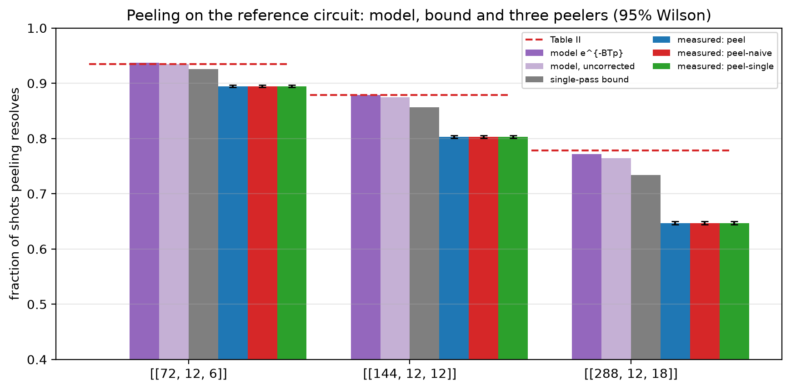

# Experiment 1 — noise-model validation and peeling (Table 5.1)

Data file: `E01_72-12-6+144-12-12+288-12-18_T12_p0.001_100000shots_seed2026110101_detRef_peel-q-naive-single_v1.json` (sha256 `40c5b31a4afa76315d40c61808c70705814552f4b05f34d4bb1e776ba061fa3b`)  
Run started: 2026-10-28T23:41:19 · status: complete  
Exported: 2026-10-28T23:43:44 by code 9a777ffec216  
Export type: fresh run

- **[[72, 12, 6]]** (z-only, depolarize2): unexplained: no peeler variant's interval contains the single-pass bound or the Table II value — all peelers resolve the same count.
- **[[144, 12, 12]]** (z-only, depolarize2): unexplained: no peeler variant's interval contains the single-pass bound or the Table II value — all peelers resolve the same count.
- **[[288, 12, 18]]** (z-only, depolarize2): unexplained: no peeler variant's interval contains the single-pass bound or the Table II value — all peelers resolve the same count.

## Table: rows

[rows.csv](rows.csv) — 9 rows

| code | rounds | p | shots | seed | extraction | gate_noise | peeler | resolved | peel | peel_lo | peel_hi | failures | time_p50_us | table_ii | sample_sha256 | workers_effective | backend | resumed_chunks | total_chunks | detectors | faults | theory_faults | fault_ratio | lam | theory_lambda | lambda_ratio | mean_degree | a0 | theory_peel | theory_peel_uncorrected | single_pass_bound | uniform_weight | column_weight | variant |
|---|---|---|---|---|---|---|---|---|---|---|---|---|---|---|---|---|---|---|---|---|---|---|---|---|---|---|---|---|---|---|---|---|---|---|
| [[72, 12, 6]] | 12 | 0.001 | 100000 | 5267765073859410435 | z-only | depolarize2 | peel | 89460 | 0.8946 | 0.8927 | 0.8965 | 7007 | 9.1 | 0.935 | 9d35be891d11891edfbc8e594f4e636d5113e1e05f22cce29eb989eb40a0c071 | 12 | parallel (12 processes); checkpoint C:\Users\user\Desktop\Thesis\Flag-Triggered-Switching\results\checkpoints\E01_72-12-6+144-12-12+288-12-18_T12_p0.001_100000shots_seed2026110101_detRef_peel-q-naive-single_v1\72-12-6_0 | 0 | 400 | 468 | 3096 | 3096 | 1 | 3.077 | 3.028 | 1.016 | 50.56 | 0.869 | 0.9372 | 0.935 | 0.9256 | True | 3 | reference circuit |
| [[72, 12, 6]] | 12 | 0.001 | 100000 | 5267765073859410435 | z-only | depolarize2 | peel-naive | 89460 | 0.8946 | 0.8927 | 0.8965 | 7007 | 9 | 0.935 | 9d35be891d11891edfbc8e594f4e636d5113e1e05f22cce29eb989eb40a0c071 | 12 | parallel (12 processes); checkpoint C:\Users\user\Desktop\Thesis\Flag-Triggered-Switching\results\checkpoints\E01_72-12-6+144-12-12+288-12-18_T12_p0.001_100000shots_seed2026110101_detRef_peel-q-naive-single_v1\72-12-6_0 | 0 | 400 | 468 | 3096 | 3096 | 1 | 3.077 | 3.028 | 1.016 | 50.56 | 0.869 | 0.9372 | 0.935 | 0.9256 | True | 3 | reference circuit |
| [[72, 12, 6]] | 12 | 0.001 | 100000 | 5267765073859410435 | z-only | depolarize2 | peel-single | 89460 | 0.8946 | 0.8927 | 0.8965 | 7007 | 7.9 | 0.935 | 9d35be891d11891edfbc8e594f4e636d5113e1e05f22cce29eb989eb40a0c071 | 12 | parallel (12 processes); checkpoint C:\Users\user\Desktop\Thesis\Flag-Triggered-Switching\results\checkpoints\E01_72-12-6+144-12-12+288-12-18_T12_p0.001_100000shots_seed2026110101_detRef_peel-q-naive-single_v1\72-12-6_0 | 0 | 400 | 468 | 3096 | 3096 | 1 | 3.077 | 3.028 | 1.016 | 50.56 | 0.869 | 0.9372 | 0.935 | 0.9256 | True | 3 | reference circuit |
| [[144, 12, 12]] | 12 | 0.001 | 100000 | 2308998763434431280 | z-only | depolarize2 | peel | 80267 | 0.8027 | 0.8002 | 0.8051 | 12319 | 13.4 | 0.879 | 90d46a7986dbd23a6ad573d72aaa1cdcfd559a37cfa1498689e10ff379113e3c | 12 | parallel (12 processes); checkpoint C:\Users\user\Desktop\Thesis\Flag-Triggered-Switching\results\checkpoints\E01_72-12-6+144-12-12+288-12-18_T12_p0.001_100000shots_seed2026110101_detRef_peel-q-naive-single_v1\144-12-12_1 | 0 | 400 | 936 | 6192 | 6192 | 1 | 6.154 | 6.057 | 1.016 | 50.56 | 0.869 | 0.8784 | 0.8743 | 0.8567 | True | 3 | reference circuit |
| [[144, 12, 12]] | 12 | 0.001 | 100000 | 2308998763434431280 | z-only | depolarize2 | peel-naive | 80267 | 0.8027 | 0.8002 | 0.8051 | 12319 | 13.1 | 0.879 | 90d46a7986dbd23a6ad573d72aaa1cdcfd559a37cfa1498689e10ff379113e3c | 12 | parallel (12 processes); checkpoint C:\Users\user\Desktop\Thesis\Flag-Triggered-Switching\results\checkpoints\E01_72-12-6+144-12-12+288-12-18_T12_p0.001_100000shots_seed2026110101_detRef_peel-q-naive-single_v1\144-12-12_1 | 0 | 400 | 936 | 6192 | 6192 | 1 | 6.154 | 6.057 | 1.016 | 50.56 | 0.869 | 0.8784 | 0.8743 | 0.8567 | True | 3 | reference circuit |
| [[144, 12, 12]] | 12 | 0.001 | 100000 | 2308998763434431280 | z-only | depolarize2 | peel-single | 80267 | 0.8027 | 0.8002 | 0.8051 | 12319 | 11.2 | 0.879 | 90d46a7986dbd23a6ad573d72aaa1cdcfd559a37cfa1498689e10ff379113e3c | 12 | parallel (12 processes); checkpoint C:\Users\user\Desktop\Thesis\Flag-Triggered-Switching\results\checkpoints\E01_72-12-6+144-12-12+288-12-18_T12_p0.001_100000shots_seed2026110101_detRef_peel-q-naive-single_v1\144-12-12_1 | 0 | 400 | 936 | 6192 | 6192 | 1 | 6.154 | 6.057 | 1.016 | 50.56 | 0.869 | 0.8784 | 0.8743 | 0.8567 | True | 3 | reference circuit |
| [[288, 12, 18]] | 12 | 0.001 | 100000 | 7512020123374631566 | z-only | depolarize2 | peel | 64687 | 0.6469 | 0.6439 | 0.6498 | 22696 | 23.2 | 0.778 | ddc66f039b6366792f134d722a1ea71878c5bbafeda346f714e5d12c93d2a3d5 | 12 | parallel (12 processes); checkpoint C:\Users\user\Desktop\Thesis\Flag-Triggered-Switching\results\checkpoints\E01_72-12-6+144-12-12+288-12-18_T12_p0.001_100000shots_seed2026110101_detRef_peel-q-naive-single_v1\288-12-18_2 | 0 | 400 | 1872 | 12384 | 12384 | 1 | 12.31 | 12.11 | 1.016 | 50.56 | 0.869 | 0.7716 | 0.7643 | 0.734 | True | 3 | reference circuit |
| [[288, 12, 18]] | 12 | 0.001 | 100000 | 7512020123374631566 | z-only | depolarize2 | peel-naive | 64687 | 0.6469 | 0.6439 | 0.6498 | 22696 | 22.7 | 0.778 | ddc66f039b6366792f134d722a1ea71878c5bbafeda346f714e5d12c93d2a3d5 | 12 | parallel (12 processes); checkpoint C:\Users\user\Desktop\Thesis\Flag-Triggered-Switching\results\checkpoints\E01_72-12-6+144-12-12+288-12-18_T12_p0.001_100000shots_seed2026110101_detRef_peel-q-naive-single_v1\288-12-18_2 | 0 | 400 | 1872 | 12384 | 12384 | 1 | 12.31 | 12.11 | 1.016 | 50.56 | 0.869 | 0.7716 | 0.7643 | 0.734 | True | 3 | reference circuit |
| [[288, 12, 18]] | 12 | 0.001 | 100000 | 7512020123374631566 | z-only | depolarize2 | peel-single | 64687 | 0.6469 | 0.6439 | 0.6498 | 22696 | 18.4 | 0.778 | ddc66f039b6366792f134d722a1ea71878c5bbafeda346f714e5d12c93d2a3d5 | 12 | parallel (12 processes); checkpoint C:\Users\user\Desktop\Thesis\Flag-Triggered-Switching\results\checkpoints\E01_72-12-6+144-12-12+288-12-18_T12_p0.001_100000shots_seed2026110101_detRef_peel-q-naive-single_v1\288-12-18_2 | 0 | 400 | 1872 | 12384 | 12384 | 1 | 12.31 | 12.11 | 1.016 | 50.56 | 0.869 | 0.7716 | 0.7643 | 0.734 | True | 3 | reference circuit |

## Table: decision

[decision.csv](decision.csv) — 3 rows

| code | rounds | p | extraction | gate_noise | single_pass_bound | table_ii | verdict | variants_identical | theory_peel | theory_peel_uncorrected |
|---|---|---|---|---|---|---|---|---|---|---|
| [[72, 12, 6]] | 12 | 0.001 | z-only | depolarize2 | 0.9256 | 0.935 | unexplained: no peeler variant's interval contains the single-pass bound or the Table II value | True | 0.9372 | 0.935 |
| [[144, 12, 12]] | 12 | 0.001 | z-only | depolarize2 | 0.8567 | 0.879 | unexplained: no peeler variant's interval contains the single-pass bound or the Table II value | True | 0.8784 | 0.8743 |
| [[288, 12, 18]] | 12 | 0.001 | z-only | depolarize2 | 0.734 | 0.778 | unexplained: no peeler variant's interval contains the single-pass bound or the Table II value | True | 0.7716 | 0.7643 |

## Figure: peeling

  
Vector version: [peeling.pdf](peeling.pdf)
