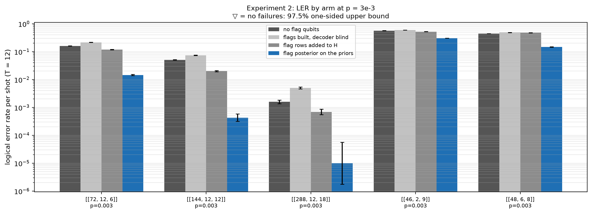

# Experiment 2 — syndrome augmentation (Table 5.7)

Data file: `E02_5codes_T12_p0.003_500000shots_seed2026110201_detZ_arms-unflagged-blind-sighted-updated_dec-OSD-0_cfgf21ef246.json` (sha256 `cbc36eb381dae89ffdd83a690eef0741ae2ac7856a7b9b4c7c5f7ae9886dbaf1`)  
Run started: 2026-10-28T23:44:27 · status: complete  
Exported: 2026-10-29T03:42:52 by code 9a777ffec216  
Export type: fresh run

## Table: arms

[arms.csv](arms.csv) — 32 rows

| code | rounds | p | shots | shard | decoder | arm | failures | ler | ci_low | ci_high | time_p50_us | time_p99_us | time_mean_us | time_update_p50_us | bp_iters_mean | detectors | qubits_used | workers | resumed_chunks | seed |
|---|---|---|---|---|---|---|---|---|---|---|---|---|---|---|---|---|---|---|---|---|
| [[72, 12, 6]] | 12 | 0.003 | 100000 | 0 | OSD-0 | blind | 21562 | 0.2156 | 0.2131 | 0.2182 | 1.118e+04 | 2.647e+04 | 1.167e+04 | 0 | 27.39 | 468 | 180 | 12 | 0 | 1069844429808496082 |
| [[72, 12, 6]] | 12 | 0.003 | 100000 | 0 | OSD-0 | sighted | 11820 | 0.1182 | 0.1162 | 0.1202 | 1.163e+04 | 2.353e+04 | 1.129e+04 | 0 | 27.12 | 900 | 180 | 12 | 0 | 1069844429808496082 |
| [[72, 12, 6]] | 12 | 0.003 | 100000 | 0 | OSD-0 | updated | 1456 | 0.01456 | 0.01384 | 0.01532 | 2414 | 8583 | 3436 | 368.4 | 14.75 | 468 | 180 | 1 | 0 | 1069844429808496082 |
| [[72, 12, 6]] | 12 | 0.003 | 100000 | 0 | OSD-0 | unflagged | 16091 | 0.1609 | 0.1586 | 0.1632 | 8554 | 1.693e+04 | 7793 | 0 | 25.31 | 468 | 144 | 12 | 0 | 301473335935154677 |
| [[144, 12, 12]] | 12 | 0.003 | 100000 | 0 | OSD-0 | blind | 7454 | 0.07454 | 0.07293 | 0.07618 | 2.368e+04 | 7.894e+04 | 2.702e+04 | 0 | 29.7 | 936 | 360 | 12 | 0 | 8729209635959335181 |
| [[144, 12, 12]] | 12 | 0.003 | 100000 | 0 | OSD-0 | sighted | 2000 | 0.02 | 0.01915 | 0.02089 | 3.002e+04 | 7.39e+04 | 3.235e+04 | 0 | 29.63 | 1800 | 360 | 12 | 0 | 8729209635959335181 |
| [[144, 12, 12]] | 12 | 0.003 | 100000 | 0 | OSD-0 | updated | 43 | 0.00043 | 0.0003193 | 0.0005791 | 8958 | 1.771e+04 | 9266 | 785 | 20.21 | 936 | 360 | 1 | 0 | 8729209635959335181 |
| [[144, 12, 12]] | 12 | 0.003 | 100000 | 0 | OSD-0 | unflagged | 5099 | 0.05099 | 0.04964 | 0.05237 | 2.279e+04 | 8.02e+04 | 2.815e+04 | 0 | 29.14 | 936 | 288 | 12 | 0 | 8624467232656599538 |
| [[288, 12, 18]] | 12 | 0.003 | 25000 | 0 | OSD-0 | blind | 113 | 0.00452 | 0.003761 | 0.005431 | 1.37e+05 | 4.652e+05 | 1.595e+05 | 0 | 30 | 1872 | 720 | 12 | 0 | 3133765218292074052 |
| [[288, 12, 18]] | 12 | 0.003 | 25000 | 0 | OSD-0 | sighted | 14 | 0.00056 | 0.0003336 | 0.0009398 | 2.991e+05 | 4.522e+05 | 2.802e+05 | 0 | 30 | 3600 | 720 | 12 | 0 | 3133765218292074052 |
| [[288, 12, 18]] | 12 | 0.003 | 25000 | 0 | OSD-0 | updated | 1 | 4e-05 | 7.061e-06 | 0.0002266 | 2.744e+04 | 3.797e+04 | 2.472e+04 | 1771 | 25.6 | 1872 | 720 | 1 | 0 | 3133765218292074052 |
| [[288, 12, 18]] | 12 | 0.003 | 25000 | 0 | OSD-0 | unflagged | 49 | 0.00196 | 0.001483 | 0.00259 | 1.783e+05 | 3.439e+05 | 1.741e+05 | 0 | 29.95 | 1872 | 576 | 12 | 0 | 7055712448019711116 |
| [[288, 12, 18]] | 12 | 0.003 | 25000 | 1 | OSD-0 | blind | 126 | 0.00504 | 0.004235 | 0.005997 | 1.815e+05 | 5.105e+05 | 1.918e+05 | 0 | 30 | 1872 | 720 | 12 | 0 | 1890003336265327133 |
| [[288, 12, 18]] | 12 | 0.003 | 25000 | 1 | OSD-0 | sighted | 24 | 0.00096 | 0.0006452 | 0.001428 | 3.034e+05 | 4.592e+05 | 2.852e+05 | 0 | 29.99 | 3600 | 720 | 12 | 0 | 1890003336265327133 |
| [[288, 12, 18]] | 12 | 0.003 | 25000 | 1 | OSD-0 | updated | 0 | 0 | 0 | 0.0001536 | 2.814e+04 | 3.805e+04 | 2.508e+04 | 1816 | 25.56 | 1872 | 720 | 1 | 0 | 1890003336265327133 |
| [[288, 12, 18]] | 12 | 0.003 | 25000 | 1 | OSD-0 | unflagged | 31 | 0.00124 | 0.0008737 | 0.00176 | 8.799e+04 | 2.756e+05 | 1.068e+05 | 0 | 29.97 | 1872 | 576 | 12 | 0 | 7352029330045838871 |
| [[288, 12, 18]] | 12 | 0.003 | 25000 | 2 | OSD-0 | blind | 122 | 0.00488 | 0.004089 | 0.005823 | 2.061e+05 | 5.082e+05 | 2.024e+05 | 0 | 30 | 1872 | 720 | 12 | 0 | 1117517290115609802 |
| [[288, 12, 18]] | 12 | 0.003 | 25000 | 2 | OSD-0 | sighted | 12 | 0.00048 | 0.0002746 | 0.0008389 | 2.666e+05 | 4.181e+05 | 2.397e+05 | 0 | 29.99 | 3600 | 720 | 12 | 0 | 1117517290115609802 |
| [[288, 12, 18]] | 12 | 0.003 | 25000 | 2 | OSD-0 | updated | 0 | 0 | 0 | 0.0001536 | 2.779e+04 | 3.828e+04 | 2.497e+04 | 1811 | 25.6 | 1872 | 720 | 1 | 0 | 1117517290115609802 |
| [[288, 12, 18]] | 12 | 0.003 | 25000 | 2 | OSD-0 | unflagged | 38 | 0.00152 | 0.001108 | 0.002086 | 1.066e+05 | 2.993e+05 | 1.256e+05 | 0 | 29.96 | 1872 | 576 | 12 | 0 | 4951892828502250541 |
| [[288, 12, 18]] | 12 | 0.003 | 25000 | 3 | OSD-0 | blind | 138 | 0.00552 | 0.004674 | 0.006517 | 1.996e+05 | 5.212e+05 | 1.991e+05 | 0 | 30 | 1872 | 720 | 12 | 0 | 5631869278647967822 |
| [[288, 12, 18]] | 12 | 0.003 | 25000 | 3 | OSD-0 | sighted | 19 | 0.00076 | 0.0004866 | 0.001187 | 2.415e+05 | 4.131e+05 | 2.243e+05 | 0 | 29.99 | 3600 | 720 | 12 | 0 | 5631869278647967822 |
| [[288, 12, 18]] | 12 | 0.003 | 25000 | 3 | OSD-0 | updated | 0 | 0 | 0 | 0.0001536 | 2.744e+04 | 3.751e+04 | 2.459e+04 | 1738 | 25.65 | 1872 | 720 | 1 | 0 | 5631869278647967822 |
| [[288, 12, 18]] | 12 | 0.003 | 25000 | 3 | OSD-0 | unflagged | 40 | 0.0016 | 0.001175 | 0.002178 | 9.536e+04 | 2.667e+05 | 1.146e+05 | 0 | 29.96 | 1872 | 576 | 12 | 0 | 5138517002675600597 |
| [[46, 2, 9]] | 12 | 0.003 | 100000 | 0 | OSD-0 | blind | 59415 | 0.5941 | 0.5911 | 0.5972 | 3.08e+04 | 9.246e+04 | 3.443e+04 | 0 | 29.84 | 299 | 115 | 12 | 0 | 8093384249381508354 |
| [[46, 2, 9]] | 12 | 0.003 | 100000 | 0 | OSD-0 | sighted | 52161 | 0.5216 | 0.5185 | 0.5247 | 3.126e+04 | 1.248e+05 | 3.742e+04 | 0 | 29.46 | 575 | 115 | 12 | 0 | 8093384249381508354 |
| [[46, 2, 9]] | 12 | 0.003 | 100000 | 0 | OSD-0 | updated | 30522 | 0.3052 | 0.3024 | 0.3081 | 1.272e+04 | 5.866e+04 | 1.592e+04 | 365.5 | 28.37 | 299 | 115 | 1 | 0 | 8093384249381508354 |
| [[46, 2, 9]] | 12 | 0.003 | 100000 | 0 | OSD-0 | unflagged | 56604 | 0.566 | 0.563 | 0.5691 | 2.295e+04 | 7.226e+04 | 2.59e+04 | 0 | 29.16 | 299 | 92 | 12 | 0 | 5833698121817342259 |
| [[48, 6, 8]] | 12 | 0.003 | 100000 | 0 | OSD-0 | blind | 48746 | 0.4875 | 0.4844 | 0.4906 | 1.272e+04 | 3.205e+04 | 1.383e+04 | 0 | 29.48 | 312 | 120 | 12 | 0 | 6100066134208387631 |
| [[48, 6, 8]] | 12 | 0.003 | 100000 | 0 | OSD-0 | sighted | 47669 | 0.4767 | 0.4736 | 0.4798 | 1.332e+04 | 3.637e+04 | 1.425e+04 | 0 | 27.64 | 600 | 120 | 12 | 0 | 6100066134208387631 |
| [[48, 6, 8]] | 12 | 0.003 | 100000 | 0 | OSD-0 | updated | 14687 | 0.1469 | 0.1447 | 0.1491 | 6206 | 1.575e+04 | 5594 | 307.9 | 21.36 | 312 | 120 | 1 | 0 | 6100066134208387631 |
| [[48, 6, 8]] | 12 | 0.003 | 100000 | 0 | OSD-0 | unflagged | 44409 | 0.4441 | 0.441 | 0.4472 | 1.001e+04 | 2.296e+04 | 9613 | 0 | 25.16 | 312 | 96 | 12 | 0 | 2991956311598655601 |

## Table: comparisons

[comparisons.csv](comparisons.csv) — 48 rows

## Table: table_5_7

[table_5_7.csv](table_5_7.csv) — 5 rows

| code | p | shots | unflagged_ler | blind_ler | sighted_ler | updated_ler |
|---|---|---|---|---|---|---|
| [[72, 12, 6]] | 0.003 | 100000 | 0.1609 | 0.2156 | 0.1182 | 0.01456 |
| [[144, 12, 12]] | 0.003 | 100000 | 0.05099 | 0.07454 | 0.02 | 0.00043 |
| [[288, 12, 18]] | 0.003 | 100000 | 0.00158 | 0.00499 | 0.00069 | 1e-05 |
| [[46, 2, 9]] | 0.003 | 100000 | 0.566 | 0.5941 | 0.5216 | 0.3052 |
| [[48, 6, 8]] | 0.003 | 100000 | 0.4441 | 0.4875 | 0.4767 | 0.1469 |

## Table: overhead

[overhead.csv](overhead.csv) — 5 rows

| code | rounds | qubits_unflagged | qubits_flagged | detectors_unflagged | detectors_flagged | flag_detectors | faults_unflagged | faults_flagged | mean_flags_per_shot | flagged_fraction |
|---|---|---|---|---|---|---|---|---|---|---|
| [[72, 12, 6]] | 12 | 144 | 180 | 468 | 900 | 432 | 4392 | 5688 | 6.645 | 0.9987 |
| [[144, 12, 12]] | 12 | 288 | 360 | 936 | 1800 | 864 | 8784 | 11376 | 13.3 | 1 |
| [[288, 12, 18]] | 12 | 576 | 720 | 1872 | 3600 | 1728 | 17568 | 22752 | 26.62 | 1 |
| [[46, 2, 9]] | 12 | 92 | 115 | 299 | 575 | 276 | 5014 | 5842 | 5.947 | 0.9977 |
| [[48, 6, 8]] | 12 | 96 | 120 | 312 | 600 | 288 | 4080 | 4944 | 5.305 | 0.9956 |

## Figure: arms

  
Vector version: [arms.pdf](arms.pdf)
