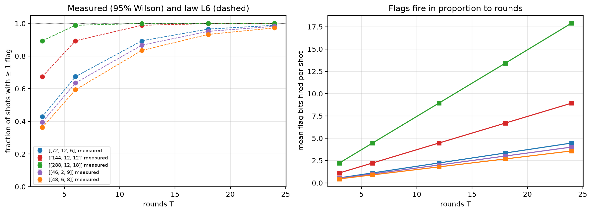

# Experiment 3 — flag rate against law L6 (Table 5.6)

Data file: `E03_5codes_T3-24x5_p0.001_200000shots_seed2026110301_flags_detZ.json` (sha256 `1898ba767a8b4eefec17daabd20d24afdfec22ca66e1c5bde6267dfe12dcd85d`)  
Run started: 2026-10-29T11:27:04 · status: complete  
Exported: 2026-10-29T11:28:28 by code 5c623b1e4691  
Export type: fresh run

## Table: flag_rate

[flag_rate.csv](flag_rate.csv) — 25 rows

| code | rounds | p | shots | seed | flag_detectors | m_x | shots_with_flag | fraction_any_flag | ci_low | ci_high | flag_bits_total | mean_flags_per_shot | S | l6_prediction | l6_per_flag_product | sample_sha256 |
|---|---|---|---|---|---|---|---|---|---|---|---|---|---|---|---|---|
| [[72, 12, 6]] | 3 | 0.001 | 200000 | 3588924346207290366 | 108 | 36 | 85727 | 0.4286 | 0.4265 | 0.4308 | 112245 | 0.5612 | 0.005177 | 0.4291 | 0.4291 | 1339f92dd99f7a2a90c66e12db02e30772894af983dbbe22346e08cd24d6f69c |
| [[72, 12, 6]] | 6 | 0.001 | 200000 | 4558982790050330186 | 216 | 36 | 134987 | 0.6749 | 0.6729 | 0.677 | 223808 | 1.119 | 0.005177 | 0.6741 | 0.6741 | 99b46cfb556f540c8411adc735a26ffdd27705de2daa1490fd6ac407c75a8790 |
| [[72, 12, 6]] | 12 | 0.001 | 200000 | 6939641431352985704 | 432 | 36 | 178342 | 0.8917 | 0.8903 | 0.8931 | 447129 | 2.236 | 0.005177 | 0.8938 | 0.8938 | 0685e3bb952ec18a6765b5cccabe09b210077d1d697b4499148b0d5312ebfaff |
| [[72, 12, 6]] | 18 | 0.001 | 200000 | 5909565041897638477 | 648 | 36 | 193220 | 0.9661 | 0.9653 | 0.9669 | 670613 | 3.353 | 0.005177 | 0.9654 | 0.9654 | 5a9426208486ca90d796bf85585e41a649a060c5df18af5ffd98b745a5219a27 |
| [[72, 12, 6]] | 24 | 0.001 | 200000 | 7673343931852843285 | 864 | 36 | 197646 | 0.9882 | 0.9877 | 0.9887 | 893805 | 4.469 | 0.005177 | 0.9887 | 0.9887 | 68b0fc0e488511e695555886fe04910f14a4a2485d62db95c14c8814cd3ea81e |
| [[144, 12, 12]] | 3 | 0.001 | 200000 | 7259060889077498173 | 216 | 72 | 134733 | 0.6737 | 0.6716 | 0.6757 | 223517 | 1.118 | 0.005177 | 0.6741 | 0.6741 | 07bad3cd71191f7acb6718ab42a299d8e10adcdb4cfc9359a78b000ff53cf76b |
| [[144, 12, 12]] | 6 | 0.001 | 200000 | 5113286433527417405 | 432 | 72 | 178676 | 0.8934 | 0.892 | 0.8947 | 446571 | 2.233 | 0.005177 | 0.8938 | 0.8938 | 7e3d00b81b9e4dfe2e0dae3e9ea0a62b3774178a3813d71255dd18dc90196ab2 |
| [[144, 12, 12]] | 12 | 0.001 | 200000 | 934015770446927225 | 864 | 72 | 197718 | 0.9886 | 0.9881 | 0.989 | 894261 | 4.471 | 0.005177 | 0.9887 | 0.9887 | 4fe64ec101b0846a6e525ed669df4810777cd5c04f8f7061942cbffd05c7d03a |
| [[144, 12, 12]] | 18 | 0.001 | 200000 | 4175908027691404770 | 1296 | 72 | 199761 | 0.9988 | 0.9986 | 0.9989 | 1340748 | 6.704 | 0.005177 | 0.9988 | 0.9988 | f3b61650db93eae28990fb635070fa3b9f76f82920306ba28802fd8d7bcf53e2 |
| [[144, 12, 12]] | 24 | 0.001 | 200000 | 6802234801511189181 | 1728 | 72 | 199960 | 0.9998 | 0.9997 | 0.9999 | 1788113 | 8.941 | 0.005177 | 0.9999 | 0.9999 | d0c81954d0f935f273d06393143f27001bb53b0c5cfb7d9a7f6dda994d8d90f0 |
| [[288, 12, 18]] | 3 | 0.001 | 200000 | 8339160184438635846 | 432 | 144 | 178514 | 0.8926 | 0.8912 | 0.8939 | 446588 | 2.233 | 0.005177 | 0.8938 | 0.8938 | 313233b7e0ae45f9bada5f62f50ee7e037bb5657cd1fcc9ad53da503f96a6107 |
| [[288, 12, 18]] | 6 | 0.001 | 200000 | 6623126790000710222 | 864 | 144 | 197699 | 0.9885 | 0.988 | 0.989 | 894724 | 4.474 | 0.005177 | 0.9887 | 0.9887 | 57b8eb3e410071c647308c7bf61369e7f3784c7c1744f7d5e68296bea21c42e2 |
| [[288, 12, 18]] | 12 | 0.001 | 200000 | 811137317517063657 | 1728 | 144 | 199980 | 0.9999 | 0.9998 | 0.9999 | 1789467 | 8.947 | 0.005177 | 0.9999 | 0.9999 | 1499b8120d8d2d660328e6d61d2b639124afaa24c8cda4bee3414e020478ec35 |
| [[288, 12, 18]] | 18 | 0.001 | 200000 | 6202345771000799936 | 2592 | 144 | 200000 | 1 | 1 | 1 | 2683368 | 13.42 | 0.005177 | 1 | 1 | 53f9939e36973e502aafda2f76e6aad0a9926a0c6e78d43208dca297cf01a3ee |
| [[288, 12, 18]] | 24 | 0.001 | 200000 | 2258565151757623850 | 3456 | 144 | 200000 | 1 | 1 | 1 | 3582945 | 17.91 | 0.005177 | 1 | 1 | 95605537a2b1a9efadafdcb2f68dc48ce89ffa99851e25df37f998f9676f8651 |
| [[46, 2, 9]] | 3 | 0.001 | 200000 | 7359200148029372389 | 69 | 23 | 79044 | 0.3952 | 0.3931 | 0.3974 | 100433 | 0.5022 | 0.007285 | 0.3962 | 0.3962 | 934ac879db8af56e685320efd45385ea3b519b09840970c2acae43c59a28e931 |
| [[46, 2, 9]] | 6 | 0.001 | 200000 | 6123120075185535956 | 138 | 23 | 127260 | 0.6363 | 0.6342 | 0.6384 | 201664 | 1.008 | 0.007285 | 0.6354 | 0.6354 | 263798743357a1178e0e97f8d04530eb12666fb6021b79f60242d000d5090a06 |
| [[46, 2, 9]] | 12 | 0.001 | 200000 | 8556798204834716701 | 276 | 23 | 173219 | 0.8661 | 0.8646 | 0.8676 | 401310 | 2.007 | 0.007285 | 0.8671 | 0.8671 | 302e0ff695c5b86812cf10e7bb354c4bcb2b563d32f659dd93de2f25e482702e |
| [[46, 2, 9]] | 18 | 0.001 | 200000 | 2012898400183344807 | 414 | 23 | 190371 | 0.9519 | 0.9509 | 0.9528 | 602829 | 3.014 | 0.007285 | 0.9515 | 0.9515 | d99e9fc0c721ca13d31e513bd4416297b9dda51daa794cabc8a12da4391c83dd |
| [[46, 2, 9]] | 24 | 0.001 | 200000 | 5999284996110939992 | 552 | 23 | 196494 | 0.9825 | 0.9819 | 0.983 | 802929 | 4.015 | 0.007285 | 0.9823 | 0.9823 | ac262f4691f7b07b1ae8ee59625212f06527fcc4c47184f98d75b64c123fb54a |
| [[48, 6, 8]] | 3 | 0.001 | 200000 | 2170684719355109780 | 72 | 24 | 72740 | 0.3637 | 0.3616 | 0.3658 | 90416 | 0.4521 | 0.006232 | 0.3624 | 0.3624 | 2379aa3012da75045cf8cb7f5f18ca3ade99690e8d82457564a9f249d4afb9af |
| [[48, 6, 8]] | 6 | 0.001 | 200000 | 2382815201844000191 | 144 | 24 | 118831 | 0.5942 | 0.592 | 0.5963 | 179619 | 0.8981 | 0.006232 | 0.5935 | 0.5935 | e579b8fe7765e6ffe28785116d362d7bd93b6ed719d06c2e881328d339484aa2 |
| [[48, 6, 8]] | 12 | 0.001 | 200000 | 1311151088672744048 | 288 | 24 | 167126 | 0.8356 | 0.834 | 0.8372 | 359416 | 1.797 | 0.006232 | 0.8348 | 0.8348 | b1a506888e50ff67b52858f131b92a7e29fa9be586e29181477ee1fa4dcb9ffd |
| [[48, 6, 8]] | 18 | 0.001 | 200000 | 6635403930783117572 | 432 | 24 | 186584 | 0.9329 | 0.9318 | 0.934 | 537149 | 2.686 | 0.006232 | 0.9328 | 0.9328 | 1d2b4eb9ac1ce81c8c9063f97b4a5c5e29863c12f9dacc964916db2916596f50 |
| [[48, 6, 8]] | 24 | 0.001 | 200000 | 5239367237396295808 | 576 | 24 | 194537 | 0.9727 | 0.972 | 0.9734 | 716980 | 3.585 | 0.006232 | 0.9727 | 0.9727 | 71e92263a4c17b67861e19dea656252738404d265f3985ede277378971920574 |

## Figure: flag_rate

  
Vector version: [flag_rate.pdf](flag_rate.pdf)
