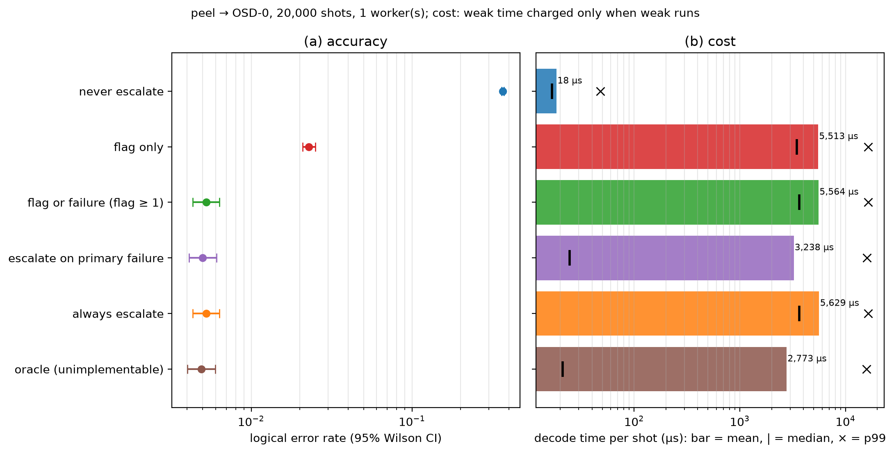
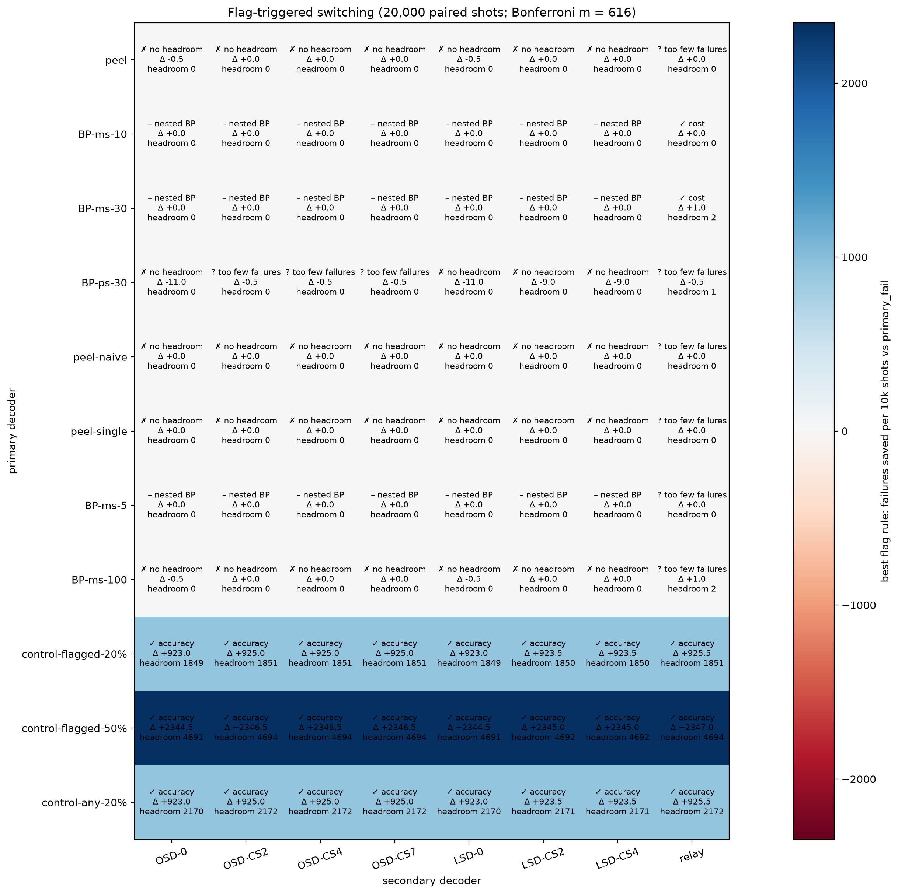
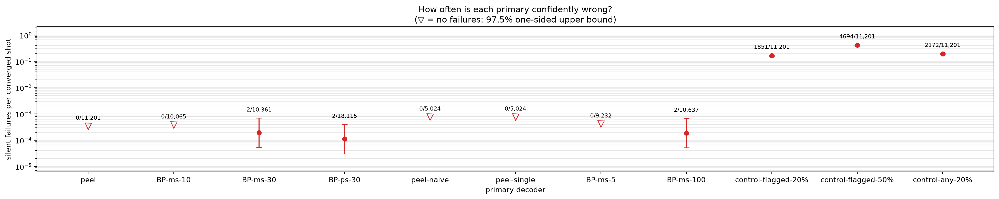
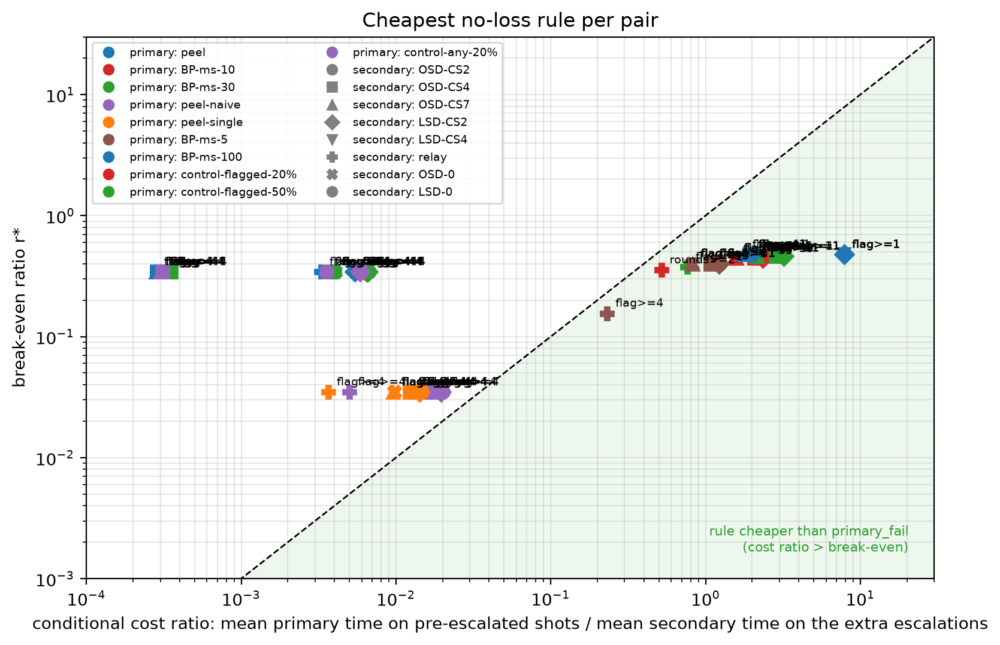
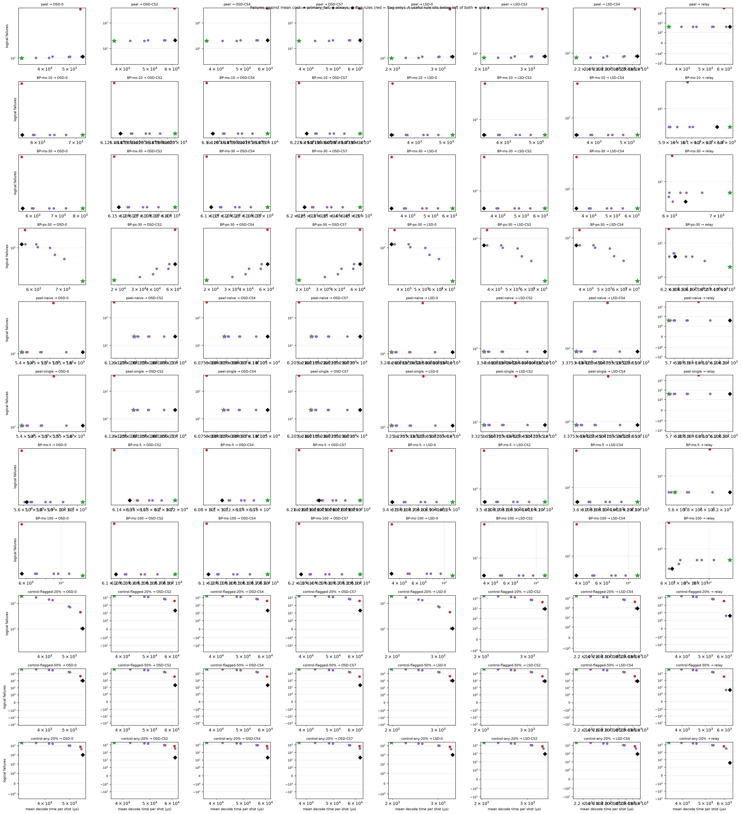

# Experiment 4 — decoder grid (20,000 shots)

Data file: `E04R_72-12-6_T12_p0.001_20000shots_seed2026110402_flags_detZ_dec38a309ff_w1.json` (sha256 `6dee89288b6c5a4e5ba4606f80c12ec8f0a5d67b8d8bd0e3996d544b4e821386`)  
Run started: 2026-10-29T12:07:09 · status: complete  
Exported: 2026-10-29T13:24:25 by code 5c623b1e4691  
Export type: fresh run

**Cost decision:** a cost saving survives the family-corrected interval for BP-ms-10 → relay (rounds>=2, +8.1%), BP-ms-30 → relay (flag>=2, +18.1%).

**Hybrid (exploratory, by construction):** 0 shots fail only under primary_fail, 5 only under always (p = 0.062); peel had 0 silent failures.

## Table: table_5_2

[table_5_2.csv](table_5_2.csv) — 6 rows

| policy | weak | strong | shots | escalation | failures | ler | ci_low | ci_high | cost_mean_us | cost_median_us | cost_p99_us | workers | cost_convention |
|---|---|---|---|---|---|---|---|---|---|---|---|---|---|
| never | peel | OSD-0 | 20000 | 0 | 7317 | 0.3659 | 0.3592 | 0.3726 | 18.45 | 16.7 | 47.9 | 1 | weak time charged only when weak runs |
| flag-only | peel | OSD-0 | 20000 | 0.8904 | 457 | 0.02285 | 0.02087 | 0.02501 | 5513 | 3460 | 1.645e+04 | 1 | weak time charged only when weak runs |
| flag>=1 | peel | OSD-0 | 20000 | 0.9144 | 105 | 0.00525 | 0.004339 | 0.006351 | 5564 | 3651 | 1.645e+04 | 1 | weak time charged only when weak runs |
| primary_fail | peel | OSD-0 | 20000 | 0.44 | 100 | 0.005 | 0.004113 | 0.006077 | 3238 | 24.5 | 1.59e+04 | 1 | weak time charged only when weak runs |
| always | peel | OSD-0 | 20000 | 1 | 105 | 0.00525 | 0.004339 | 0.006351 | 5629 | 3655 | 1.645e+04 | 1 | weak time charged only when weak runs |
| oracle | peel | OSD-0 | 20000 | 0.3659 | 98 | 0.0049 | 0.004023 | 0.005967 | 2773 | 21.1 | 1.576e+04 | 1 | weak time charged only when weak runs |

## Table: table_5_3

[table_5_3.csv](table_5_3.csv) — 8 rows

| weak | strong | rule | failures | ler | escalation | pre_rate | silent | unconverged | catch | harm | worse | better | p | p_adj | cost_us | pf_cost_us | always_cost_us | saving | saving_vs_always | saving_ci | breakeven | cost_ratio_cond | flag_informative | workers | nested | placebo_failures | placebo_worse | placebo_better | placebo_p_adj | cost_viable |
|---|---|---|---|---|---|---|---|---|---|---|---|---|---|---|---|---|---|---|---|---|---|---|---|---|---|---|---|---|---|---|
| peel | OSD-0 | primary_fail | 100 | [0.005, 0.004113, 0.006077] | 0.44 | 0 | 0 | 0 | 0 | 0 | 0 | 0 | 1 | 1 | 3238 | 3238 | 5629 | 0 | 0 | [nan, nan] | nan | nan | None | 1 | False |  |  |  |  |  |
| peel | OSD-0 | flag>=1 | 105 | [0.00525, 0.004339, 0.006351] | 0.9144 | 0.8904 | 0 | 0 | 0 | 5 | 5 | 0 | 0.0625 | 1 | 5564 | 3238 | 5629 | -0.718 | 0.01163 | [-0.7646, -0.6715] | 0.5329 | 0.00386 | False | 1 | False | 105 | 0 | 0 | 1 | False |
| peel | OSD-0 | flag>=2 | 105 | [0.00525, 0.004339, 0.006351] | 0.7518 | 0.6503 | 0 | 0 | 0 | 5 | 5 | 0 | 0.0625 | 1 | 5017 | 3238 | 5629 | -0.5493 | 0.1087 | [-0.5886, -0.5101] | 0.4795 | 0.003527 | False | 1 | False | 103 | 2 | 0 | 1 | False |
| peel | OSD-0 | flag>=3 | 105 | [0.00525, 0.004339, 0.006351] | 0.5995 | 0.3832 | 0 | 0 | 0 | 5 | 5 | 0 | 0.0625 | 1 | 4285 | 3238 | 5629 | -0.323 | 0.2389 | [-0.3505, -0.2955] | 0.4164 | 0.003341 | False | 1 | False | 104 | 1 | 0 | 1 | False |
| peel | OSD-0 | flag>=4 | 101 | [0.00505, 0.004158, 0.006132] | 0.5025 | 0.1825 | 0 | 0 | 0 | 1 | 1 | 0 | 1 | 1 | 3689 | 3238 | 5629 | -0.1391 | 0.3447 | [-0.1553, -0.1229] | 0.3428 | 0.003294 | False | 1 | False | 100 | 1 | 0 | 1 | False |
| peel | OSD-0 | rounds>=2 | 104 | [0.0052, 0.004294, 0.006296] | 0.7402 | 0.628 | 0 | 0 | 0 | 4 | 4 | 0 | 0.125 | 1 | 4965 | 3238 | 5629 | -0.533 | 0.1181 | [-0.5719, -0.4941] | 0.4781 | 0.003517 | False | 1 | False | 102 | 2 | 0 | 1 | False |
| peel | OSD-0 | rounds>=3 | 101 | [0.00505, 0.004158, 0.006132] | 0.576 | 0.331 | 0 | 0 | 0 | 1 | 1 | 0 | 1 | 1 | 4144 | 3238 | 5629 | -0.2797 | 0.2638 | [-0.3065, -0.2529] | 0.4112 | 0.003331 | False | 1 | False | 102 | 0 | 1 | 1 | False |
| peel | OSD-0 | flag-only | 457 | [0.02285, 0.02087, 0.02501] | 0.8904 | 0.8904 | 0 | 352 | 0 | 5 | 357 | 0 | 6.813e-108 | 4.197e-105 | 5513 | 3238 | 5629 | -0.7023 | 0.02068 | [-0.749, -0.6556] | nan | nan | True | 1 | False | 914 | 314 | 771 | 4.091e-42 | False |

## Table: table_5_4

[table_5_4.csv](table_5_4.csv) — 19 rows

| decoder | flagged_fraction | error_rate_flagged | error_rate_unflagged | risk_ratio | mutual_information_bits | share_of_failures_on_flagged |
|---|---|---|---|---|---|---|
| peel | 0.8904 | 0.3911 | 0.1606 | 2.436 | 0.01806 | 0.9519 |
| BP-ms-10 | 0.8904 | 0.4125 | 0.01551 | 26.59 | 0.0666 | 0.9954 |
| BP-ms-30 | 0.8904 | 0.4009 | 0.01323 | 30.31 | 0.06524 | 0.996 |
| BP-ps-30 | 0.8904 | 0.07873 | 0.01004 | 7.844 | 0.007407 | 0.9846 |
| peel-naive | 0.8904 | 0.6557 | 0.1606 | 4.083 | 0.07335 | 0.9707 |
| peel-single | 0.8904 | 0.6557 | 0.1606 | 4.083 | 0.07335 | 0.9707 |
| BP-ms-5 | 0.8904 | 0.5089 | 0.0187 | 27.21 | 0.08931 | 0.9955 |
| BP-ms-100 | 0.8904 | 0.3899 | 0.01323 | 29.47 | 0.0627 | 0.9958 |
| control-flagged-20% | 0.8904 | 0.4951 | 0.1606 | 3.083 | 0.03499 | 0.9616 |
| control-flagged-50% | 0.8904 | 0.6547 | 0.1606 | 4.077 | 0.07307 | 0.9707 |
| control-any-20% | 0.8904 | 0.4951 | 0.307 | 1.612 | 0.01027 | 0.9291 |
| OSD-0 | 0.8904 | 0.005896 | 0 | inf | 0.0008817 | 1 |
| OSD-CS2 | 0.8904 | 0.001179 | 0 | inf | 0.0001759 | 1 |
| OSD-CS4 | 0.8904 | 0.001179 | 0 | inf | 0.0001759 | 1 |
| OSD-CS7 | 0.8904 | 0.001179 | 0 | inf | 0.0001759 | 1 |
| LSD-0 | 0.8904 | 0.005896 | 0 | inf | 0.0008817 | 1 |
| LSD-CS2 | 0.8904 | 0.00511 | 0 | inf | 0.0007639 | 1 |
| LSD-CS4 | 0.8904 | 0.005054 | 0 | inf | 0.0007554 | 1 |
| relay | 0.8904 | 0.0002246 | 0 | inf | 3.35e-05 | 1 |

## Table: table_5_5

[table_5_5.csv](table_5_5.csv) — 88 rows

## Table: cost_reanalysis

[cost_reanalysis.csv](cost_reanalysis.csv) — 6 rows

| weak | strong | policy | shots_used | chunk_starts_excluded | failures | escalation | mean_us | median_us | trimmed_mean_us | saving_vs_always | saving_vs_primary_fail | cost_convention |
|---|---|---|---|---|---|---|---|---|---|---|---|---|
| peel | OSD-0 | never | 19920 | True | 7317 | 0 | 18.44 | 16.7 | 18.06 | 0.9967 | 0.9943 | weak time charged only when weak runs |
| peel | OSD-0 | flag-only | 19920 | True | 457 | 0.8904 | 5515 | 3466 | 5433 | 0.02066 | -0.702 | weak time charged only when weak runs |
| peel | OSD-0 | flag>=1 | 19920 | True | 105 | 0.9144 | 5566 | 3659 | 5485 | 0.01162 | -0.7178 | weak time charged only when weak runs |
| peel | OSD-0 | primary_fail | 19920 | True | 100 | 0.44 | 3240 | 24.5 | 3129 | 0.4246 | 0 | weak time charged only when weak runs |
| peel | OSD-0 | always | 19920 | True | 105 | 1 | 5632 | 3663 | 5546 | 0 | -0.738 | weak time charged only when weak runs |
| peel | OSD-0 | oracle | 19920 | True | 98 | 0.3659 | 2775 | 21.1 | 2656 | 0.5072 | 0.1436 | weak time charged only when weak runs |

## Table: all_rules

[all_rules.csv](all_rules.csv) — 704 rows

## Table: strong_ceiling

[strong_ceiling.csv](strong_ceiling.csv) — 56 rows

## Figure: reference_policies

  
Vector version: [reference_policies.pdf](reference_policies.pdf)

## Figure: verdicts

  
Vector version: [verdicts.pdf](verdicts.pdf)

## Figure: silent

  
Vector version: [silent.pdf](silent.pdf)

## Figure: breakeven

  
Vector version: [breakeven.pdf](breakeven.pdf)

## Figure: tradeoffs

  
Vector version: [tradeoffs.pdf](tradeoffs.pdf)
