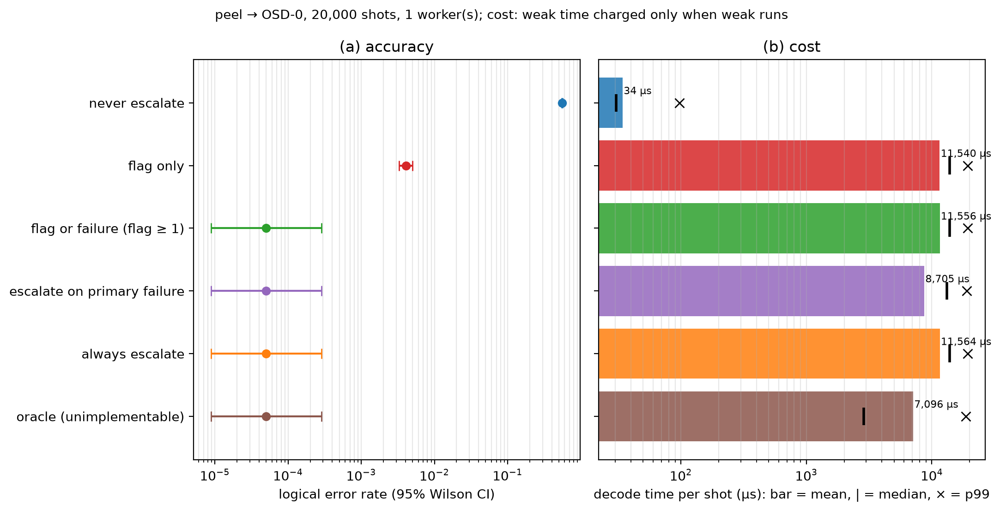
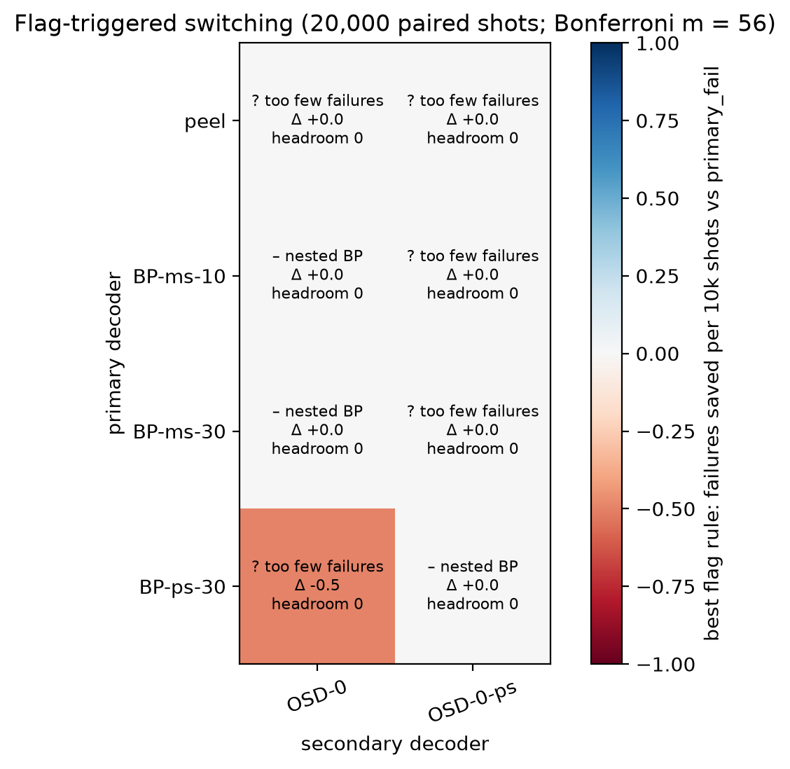
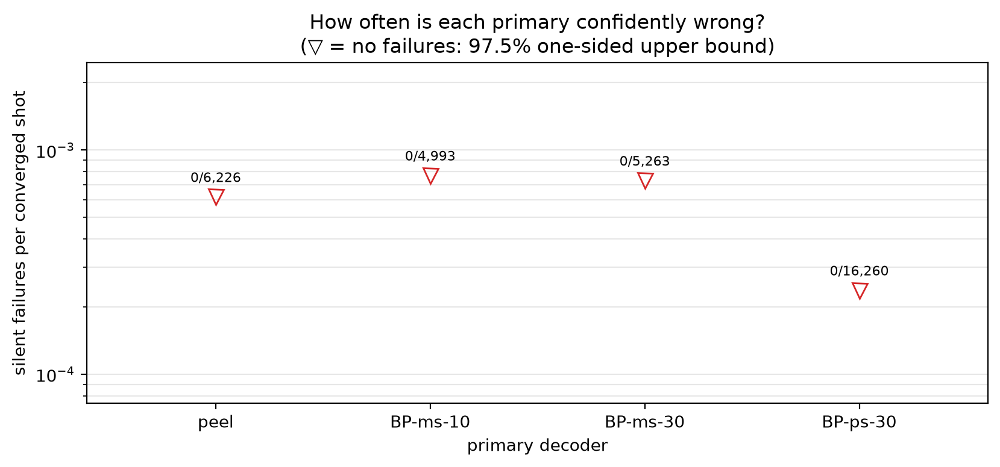
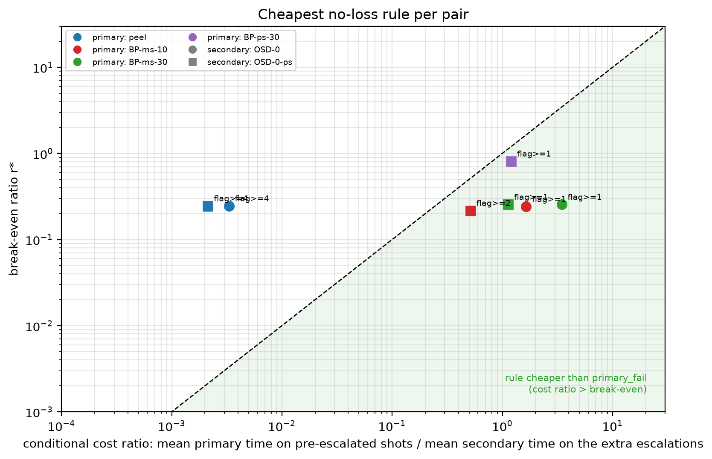
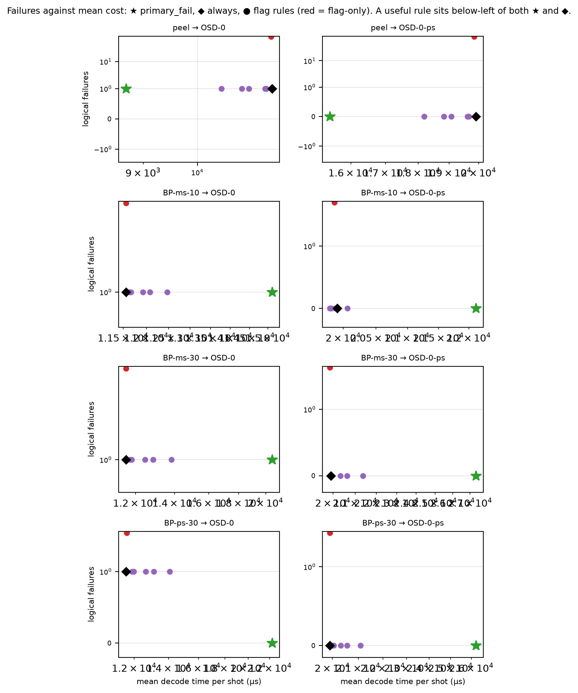

# Experiment 4 — decoder grid (20,000 shots)

Data file: `E04_144-12-12_T12_p0.001_20000shots_seed2026110402_flags_detZ_dec0d782fa0_w1.json` (sha256 `0ff23881bc9399ab7dcc8a620fffe02bd9e7dcd897354b23cb595a592aef4d94`)  
Run started: 2026-10-29T22:43:24 · status: complete  
Exported: 2026-10-29T23:05:15 by code 4f290232cf46  
Export type: fresh run

**Cost decision:** no rule with zero accuracy loss has a family-corrected saving interval that excludes zero against both `primary_fail` and `always`; the "viable on cost" claim is not supported by this file.

**Hybrid (exploratory, by construction):** 0 shots fail only under primary_fail, 0 only under always (p = 1); peel had 0 silent failures.

## Table: table_5_2

[table_5_2.csv](table_5_2.csv) — 6 rows

| policy | weak | strong | shots | escalation | failures | ler | ci_low | ci_high | cost_mean_us | cost_median_us | cost_p99_us | workers | cost_convention |
|---|---|---|---|---|---|---|---|---|---|---|---|---|---|
| never | peel | OSD-0 | 20000 | 0 | 11072 | 0.5536 | 0.5467 | 0.5605 | 34.33 | 30.4 | 97.4 | 1 | weak time charged only when weak runs |
| flag-only | peel | OSD-0 | 20000 | 0.988 | 81 | 0.00405 | 0.00326 | 0.005031 | 1.154e+04 | 1.382e+04 | 1.921e+04 | 1 | weak time charged only when weak runs |
| flag>=1 | peel | OSD-0 | 20000 | 0.9932 | 1 | 5e-05 | 8.826e-06 | 0.0002832 | 1.156e+04 | 1.383e+04 | 1.921e+04 | 1 | weak time charged only when weak runs |
| primary_fail | peel | OSD-0 | 20000 | 0.6887 | 1 | 5e-05 | 8.826e-06 | 0.0002832 | 8705 | 1.312e+04 | 1.893e+04 | 1 | weak time charged only when weak runs |
| always | peel | OSD-0 | 20000 | 1 | 1 | 5e-05 | 8.826e-06 | 0.0002832 | 1.156e+04 | 1.383e+04 | 1.921e+04 | 1 | weak time charged only when weak runs |
| oracle | peel | OSD-0 | 20000 | 0.5536 | 1 | 5e-05 | 8.826e-06 | 0.0002832 | 7096 | 2877 | 1.873e+04 | 1 | weak time charged only when weak runs |

## Table: table_5_3

[table_5_3.csv](table_5_3.csv) — 8 rows

| weak | strong | rule | failures | ler | escalation | pre_rate | silent | unconverged | catch | harm | worse | better | p | p_adj | cost_us | pf_cost_us | always_cost_us | saving | saving_vs_always | saving_ci | breakeven | cost_ratio_cond | flag_informative | workers | nested | placebo_failures | placebo_worse | placebo_better | placebo_p_adj | cost_viable |
|---|---|---|---|---|---|---|---|---|---|---|---|---|---|---|---|---|---|---|---|---|---|---|---|---|---|---|---|---|---|---|
| peel | OSD-0 | primary_fail | 1 | [5e-05, 8.826e-06, 0.0002832] | 0.6887 | 0 | 0 | 0 | 0 | 0 | 0 | 0 | 1 | 1 | 8705 | 8705 | 1.156e+04 | 0 | 0 | [nan, nan] | nan | nan | None | 1 | False |  |  |  |  |  |
| peel | OSD-0 | flag>=1 | 1 | [5e-05, 8.826e-06, 0.0002832] | 0.9932 | 0.988 | 0 | 0 | 0 | 0 | 0 | 0 | 1 | 1 | 1.156e+04 | 8705 | 1.156e+04 | -0.3274 | 0.0007129 | [-0.3417, -0.3132] | 0.3082 | 0.003637 | False | 1 | False | 1 | 0 | 0 | 1 | False |
| peel | OSD-0 | flag>=2 | 1 | [5e-05, 8.826e-06, 0.0002832] | 0.9663 | 0.9381 | 0 | 0 | 0 | 0 | 0 | 0 | 1 | 1 | 1.143e+04 | 8705 | 1.156e+04 | -0.3136 | 0.01116 | [-0.3276, -0.2995] | 0.2959 | 0.003511 | False | 1 | False | 1 | 0 | 0 | 1 | False |
| peel | OSD-0 | flag>=3 | 1 | [5e-05, 8.826e-06, 0.0002832] | 0.9145 | 0.8214 | 0 | 0 | 0 | 0 | 0 | 0 | 1 | 1 | 1.105e+04 | 8705 | 1.156e+04 | -0.2696 | 0.04426 | [-0.2831, -0.2561] | 0.2749 | 0.003402 | False | 1 | False | 1 | 0 | 0 | 1 | False |
| peel | OSD-0 | flag>=4 | 1 | [5e-05, 8.826e-06, 0.0002832] | 0.8485 | 0.6517 | 0 | 0 | 0 | 0 | 0 | 0 | 1 | 1 | 1.048e+04 | 8705 | 1.156e+04 | -0.2033 | 0.09414 | [-0.2156, -0.1911] | 0.2452 | 0.003303 | False | 1 | False | 1 | 0 | 0 | 1 | False |
| peel | OSD-0 | rounds>=2 | 1 | [5e-05, 8.826e-06, 0.0002832] | 0.962 | 0.9268 | 0 | 0 | 0 | 0 | 0 | 0 | 1 | 1 | 1.141e+04 | 8705 | 1.156e+04 | -0.3105 | 0.01345 | [-0.3244, -0.2967] | 0.2949 | 0.0035 | False | 1 | False | 1 | 0 | 0 | 1 | False |
| peel | OSD-0 | rounds>=3 | 1 | [5e-05, 8.826e-06, 0.0002832] | 0.8974 | 0.7733 | 0 | 0 | 0 | 0 | 0 | 0 | 1 | 1 | 1.091e+04 | 8705 | 1.156e+04 | -0.2528 | 0.0569 | [-0.2659, -0.2396] | 0.2699 | 0.00338 | False | 1 | False | 1 | 0 | 0 | 1 | False |
| peel | OSD-0 | flag-only | 81 | [0.00405, 0.00326, 0.005031] | 0.988 | 0.988 | 0 | 80 | 0 | 0 | 80 | 0 | 1.654e-24 | 9.264e-23 | 1.154e+04 | 8705 | 1.156e+04 | -0.3256 | 0.002089 | [-0.34, -0.3112] | nan | nan | True | 1 | False | 135 | 80 | 134 | 0.01524 | False |

## Table: table_5_4

[table_5_4.csv](table_5_4.csv) — 6 rows

| decoder | flagged_fraction | error_rate_flagged | error_rate_unflagged | risk_ratio | mutual_information_bits | share_of_failures_on_flagged |
|---|---|---|---|---|---|---|
| peel | 0.988 | 0.5563 | 0.3333 | 1.669 | 0.001722 | 0.9928 |
| BP-ms-10 | 0.988 | 0.4912 | 0.025 | 19.65 | 0.009599 | 0.9994 |
| BP-ms-30 | 0.988 | 0.4778 | 0.02083 | 22.94 | 0.009441 | 0.9995 |
| BP-ps-30 | 0.988 | 0.1197 | 0.0125 | 9.579 | 0.001465 | 0.9987 |
| OSD-0 | 0.988 | 5.061e-05 | 0 | inf | 8.709e-07 | 1 |
| OSD-0-ps | 0.988 | 0 | 0 | inf | 0 | nan |

## Table: table_5_5

[table_5_5.csv](table_5_5.csv) — 8 rows

| weak | strong | verdict | verdict_accuracy | verdict_cost | nested | nested_mismatch | headroom | m | alpha_family | min_detectable_discordant | pf_failures | pf_escalation | pf_cost_us | always_failures | always_cost_us | best_accuracy_rule | best_cost_rule | best_saving | best_saving_vs_always | median_time_ratio | workers |
|---|---|---|---|---|---|---|---|---|---|---|---|---|---|---|---|---|---|---|---|---|---|
| peel | OSD-0 | inconclusive | inconclusive | not viable | False | None | 0 | 56 | 0.0008929 | 12 | 1 | 0.6887 | 8705 | 1 | 1.156e+04 | None | None | 0 | 0 | 0.002199 | 1 |
| peel | OSD-0-ps | inconclusive | inconclusive | not viable | False | None | 0 | 56 | 0.0008929 | 12 | 0 | 0.6887 | 1.543e+04 | 0 | 1.991e+04 | None | None | 0 | 0 | 0.0017 | 1 |
| BP-ms-10 | OSD-0 | impossible by construction: strong decoder re-runs the weak BP | impossible by construction: strong decoder re-runs the weak BP | not attributable | True | 0 | 0 | 56 | 0.0008929 | 12 | 1 | 0.7503 | 1.512e+04 | 1 | 1.156e+04 | None | None | 0 | 0 | 0.3093 | 1 |
| BP-ms-10 | OSD-0-ps | inconclusive | inconclusive | not viable | False | None | 0 | 56 | 0.0008929 | 12 | 0 | 0.7503 | 2.212e+04 | 0 | 1.991e+04 | None | None | 0 | 0 | 0.2391 | 1 |
| BP-ms-30 | OSD-0 | impossible by construction: strong decoder re-runs the weak BP | impossible by construction: strong decoder re-runs the weak BP | not attributable | True | 0 | 0 | 56 | 0.0008929 | 12 | 1 | 0.7369 | 2.051e+04 | 1 | 1.156e+04 | None | None | 0 | 0 | 0.8269 | 1 |
| BP-ms-30 | OSD-0-ps | inconclusive | inconclusive | not viable | False | None | 0 | 56 | 0.0008929 | 12 | 0 | 0.7369 | 2.735e+04 | 0 | 1.991e+04 | None | None | 0 | 0 | 0.6391 | 1 |
| BP-ps-30 | OSD-0 | inconclusive | inconclusive | not viable | False | None | 0 | 56 | 0.0008929 | 12 | 0 | 0.187 | 2.225e+04 | 1 | 1.156e+04 | None | None | 0 | 0 | 1.285 | 1 |
| BP-ps-30 | OSD-0-ps | impossible by construction: strong decoder re-runs the weak BP | impossible by construction: strong decoder re-runs the weak BP | not attributable | True | 0 | 0 | 56 | 0.0008929 | 12 | 0 | 0.187 | 2.622e+04 | 0 | 1.991e+04 | None | None | 0 | 0 | 0.993 | 1 |

## Table: cost_reanalysis

[cost_reanalysis.csv](cost_reanalysis.csv) — 6 rows

| weak | strong | policy | shots_used | chunk_starts_excluded | failures | escalation | mean_us | median_us | trimmed_mean_us | saving_vs_always | saving_vs_primary_fail | cost_convention |
|---|---|---|---|---|---|---|---|---|---|---|---|---|
| peel | OSD-0 | never | 19920 | True | 11072 | 0 | 34.31 | 30.3 | 32.84 | 0.997 | 0.9961 | weak time charged only when weak runs |
| peel | OSD-0 | flag-only | 19920 | True | 81 | 0.988 | 1.154e+04 | 1.382e+04 | 1.151e+04 | 0.002097 | -0.3248 | weak time charged only when weak runs |
| peel | OSD-0 | flag>=1 | 19920 | True | 1 | 0.9932 | 1.156e+04 | 1.383e+04 | 1.152e+04 | 0.0007157 | -0.3266 | weak time charged only when weak runs |
| peel | OSD-0 | primary_fail | 19920 | True | 1 | 0.6887 | 8712 | 1.313e+04 | 8639 | 0.2467 | 0 | weak time charged only when weak runs |
| peel | OSD-0 | always | 19920 | True | 1 | 1 | 1.157e+04 | 1.383e+04 | 1.152e+04 | 0 | -0.3276 | weak time charged only when weak runs |
| peel | OSD-0 | oracle | 19920 | True | 1 | 0.5536 | 7098 | 2879 | 6997 | 0.3863 | 0.1852 | weak time charged only when weak runs |

## Table: all_rules

[all_rules.csv](all_rules.csv) — 64 rows

## Table: strong_ceiling

[strong_ceiling.csv](strong_ceiling.csv) — 2 rows

| decoder | compared_with | failures | fixed_by_other | broken_by_other |
|---|---|---|---|---|
| OSD-0 | OSD-0-ps | 1 | 1 | 0 |
| OSD-0-ps | OSD-0 | 0 | 0 | 1 |

## Figure: reference_policies

  
Vector version: [reference_policies.pdf](reference_policies.pdf)

## Figure: verdicts

  
Vector version: [verdicts.pdf](verdicts.pdf)

## Figure: silent

  
Vector version: [silent.pdf](silent.pdf)

## Figure: breakeven

  
Vector version: [breakeven.pdf](breakeven.pdf)

## Figure: tradeoffs

  
Vector version: [tradeoffs.pdf](tradeoffs.pdf)
