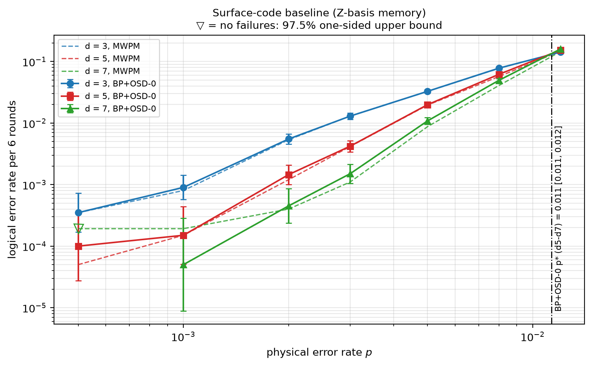

# Experiment 6 — surface-code baseline (Fig. 5.1)

Data file: `E06_T6_p0.0005-0.012x7_20000shots_seed2026110601_osd0_detSurfZ_d3-5-7_sweep_mwpm.json` (sha256 `1d31b87573462349e9e15e1145b64fa3fa44e7b5e65b341e7530ec5498547e2c`)  
Run started: 2026-10-29T14:51:46 · status: complete  
Exported: 2026-10-29T14:52:54 by code 5c623b1e4691  
Export type: fresh run

- OSD d5-d7: p* = 0.011 [0.011, 0.012] (no crossing in 4% of resamples)
- OSD d3-d5: p* = 0.011 [0.01, 0.011] (no crossing in 0% of resamples)
- OSD d3-d7: p* = 0.011 [0.011, 0.011] (no crossing in 0% of resamples)
- MWPM d5-d7: no crossing in range
- MWPM d3-d5: p* = 0.012 [0.011, 0.012] (no crossing in 11% of resamples)
- MWPM d3-d7: p* = 0.012 [0.012, 0.012] (no crossing in 36% of resamples)

## Table: points

[points.csv](points.csv) — 21 rows

| distance | rounds | p | shots | seed | osd_order | failures | ler | ci_low | ci_high | mwpm_failures | mwpm_ler | mwpm_ci_low | mwpm_ci_high | osd_only | mwpm_only | mcnemar_p | detectors | faults | qubits_used | qubit_index_span | detector_convention | x_detectors | backend | workers_effective | resumed_chunks | total_chunks | time_p50_us | mwpm_time_us_per_shot | sample_sha256 |
|---|---|---|---|---|---|---|---|---|---|---|---|---|---|---|---|---|---|---|---|---|---|---|---|---|---|---|---|---|---|
| 3 | 6 | 0.0005 | 20000 | 173099731018527246 | 0 | 7 | 0.00035 | 0.0001696 | 0.0007224 | 7 | 0.00035 | 0.0001696 | 0.0007224 | 0 | 0 | 1 | 28 | 103 | 17 | 26 | surface-z-only | False | sequential; checkpoint C:\Users\user\Desktop\Thesis\Flag-Triggered-Switching\results\checkpoints\E06_T6_p0.0005-0.012x7_20000shots_seed2026110601_osd0_detSurfZ_d3-5-7_sweep_mwpm\d3_p0.0005 | 1 | 0 | 80 | 2.6 | 0.09735 | f5cdf08c08fae09c7253adf369c787ed5a628dd5b16930ac34a51941d625b297 |
| 3 | 6 | 0.001 | 20000 | 4535602499000199125 | 0 | 18 | 0.0009 | 0.0005694 | 0.001422 | 16 | 0.0008 | 0.0004925 | 0.001299 | 2 | 0 | 0.5 | 28 | 103 | 17 | 26 | surface-z-only | False | sequential; checkpoint C:\Users\user\Desktop\Thesis\Flag-Triggered-Switching\results\checkpoints\E06_T6_p0.0005-0.012x7_20000shots_seed2026110601_osd0_detSurfZ_d3-5-7_sweep_mwpm\d3_p0.001 | 1 | 0 | 80 | 3.9 | 0.1027 | f12b7fc6afef008607e37f91ff7014ae0b5e89ef40aeb99e5f9173d2a75551d4 |
| 3 | 6 | 0.002 | 20000 | 8691711838561684084 | 0 | 110 | 0.0055 | 0.004566 | 0.006624 | 107 | 0.00535 | 0.00443 | 0.00646 | 4 | 1 | 0.375 | 28 | 103 | 17 | 26 | surface-z-only | False | sequential; checkpoint C:\Users\user\Desktop\Thesis\Flag-Triggered-Switching\results\checkpoints\E06_T6_p0.0005-0.012x7_20000shots_seed2026110601_osd0_detSurfZ_d3-5-7_sweep_mwpm\d3_p0.002 | 1 | 0 | 80 | 4.1 | 0.1411 | bb85470d1a05217612979806b965f2dabec2b43ab073b47b99e2f891730c0731 |
| 3 | 6 | 0.003 | 20000 | 5814277689686735778 | 0 | 259 | 0.01295 | 0.01147 | 0.01461 | 260 | 0.013 | 0.01152 | 0.01467 | 2 | 3 | 1 | 28 | 103 | 17 | 26 | surface-z-only | False | sequential; checkpoint C:\Users\user\Desktop\Thesis\Flag-Triggered-Switching\results\checkpoints\E06_T6_p0.0005-0.012x7_20000shots_seed2026110601_osd0_detSurfZ_d3-5-7_sweep_mwpm\d3_p0.003 | 1 | 0 | 80 | 5 | 0.3208 | a20bc6c9a1a9e3f4d3337ac57900e81c9fe3c595fc014144d3ec6bf866847104 |
| 3 | 6 | 0.005 | 20000 | 6990880172785575064 | 0 | 656 | 0.0328 | 0.03042 | 0.03536 | 654 | 0.0327 | 0.03032 | 0.03526 | 12 | 10 | 0.8318 | 28 | 103 | 17 | 26 | surface-z-only | False | sequential; checkpoint C:\Users\user\Desktop\Thesis\Flag-Triggered-Switching\results\checkpoints\E06_T6_p0.0005-0.012x7_20000shots_seed2026110601_osd0_detSurfZ_d3-5-7_sweep_mwpm\d3_p0.005 | 1 | 0 | 80 | 8.6 | 0.3898 | 9abf80c6060937388a084c8055bc720cfc1828b63f299cd9bca54145e840daa1 |
| 3 | 6 | 0.008 | 20000 | 3842892616900549177 | 0 | 1559 | 0.07795 | 0.07431 | 0.08175 | 1549 | 0.07745 | 0.07383 | 0.08124 | 40 | 30 | 0.282 | 28 | 103 | 17 | 26 | surface-z-only | False | sequential; checkpoint C:\Users\user\Desktop\Thesis\Flag-Triggered-Switching\results\checkpoints\E06_T6_p0.0005-0.012x7_20000shots_seed2026110601_osd0_detSurfZ_d3-5-7_sweep_mwpm\d3_p0.008 | 1 | 0 | 80 | 11.6 | 0.5904 | c4ccd16693a0cfcf881b6409ff29d4889e0e6d7c4e43eb3b7eb2e6c510e88fda |
| 3 | 6 | 0.012 | 20000 | 8396782138643061434 | 0 | 2841 | 0.1421 | 0.1373 | 0.147 | 2868 | 0.1434 | 0.1386 | 0.1483 | 87 | 114 | 0.0664 | 28 | 103 | 17 | 26 | surface-z-only | False | sequential; checkpoint C:\Users\user\Desktop\Thesis\Flag-Triggered-Switching\results\checkpoints\E06_T6_p0.0005-0.012x7_20000shots_seed2026110601_osd0_detSurfZ_d3-5-7_sweep_mwpm\d3_p0.012 | 1 | 0 | 80 | 45.3 | 0.9691 | d49d0e8399bb0fef55ca99a9fdcd40a315a4fd1ab6bf05802f4593d9df06938f |
| 5 | 6 | 0.0005 | 20000 | 5649451060059256494 | 0 | 2 | 0.0001 | 2.742e-05 | 0.0003646 | 1 | 5e-05 | 8.826e-06 | 0.0002832 | 1 | 0 | 1 | 84 | 357 | 49 | 64 | surface-z-only | False | sequential; checkpoint C:\Users\user\Desktop\Thesis\Flag-Triggered-Switching\results\checkpoints\E06_T6_p0.0005-0.012x7_20000shots_seed2026110601_osd0_detSurfZ_d3-5-7_sweep_mwpm\d5_p0.0005 | 1 | 0 | 80 | 6.3 | 0.2731 | 1040b532554cb2d0d214cbea49eec405f70c780ccb2af896ad3261e92a9b34de |
| 5 | 6 | 0.001 | 20000 | 8814232216374109849 | 0 | 3 | 0.00015 | 5.101e-05 | 0.000441 | 3 | 0.00015 | 5.101e-05 | 0.000441 | 0 | 0 | 1 | 84 | 357 | 49 | 64 | surface-z-only | False | sequential; checkpoint C:\Users\user\Desktop\Thesis\Flag-Triggered-Switching\results\checkpoints\E06_T6_p0.0005-0.012x7_20000shots_seed2026110601_osd0_detSurfZ_d3-5-7_sweep_mwpm\d5_p0.001 | 1 | 0 | 80 | 10.3 | 0.3967 | e5e035b501d7c7716204d67a9ce03642dd4d9d904ddf4b19950921c1196f44cd |
| 5 | 6 | 0.002 | 20000 | 6656483285911623522 | 0 | 29 | 0.00145 | 0.00101 | 0.002082 | 24 | 0.0012 | 0.0008066 | 0.001785 | 5 | 0 | 0.0625 | 84 | 357 | 49 | 64 | surface-z-only | False | sequential; checkpoint C:\Users\user\Desktop\Thesis\Flag-Triggered-Switching\results\checkpoints\E06_T6_p0.0005-0.012x7_20000shots_seed2026110601_osd0_detSurfZ_d3-5-7_sweep_mwpm\d5_p0.002 | 1 | 0 | 80 | 26.5 | 0.5233 | 7604ab681b585df6d444b11af50c4cd01ba2ba333d848ebe1de3cd74649ea780 |
| 5 | 6 | 0.003 | 20000 | 1001549080255434855 | 0 | 84 | 0.0042 | 0.003394 | 0.005196 | 83 | 0.00415 | 0.003349 | 0.005141 | 12 | 11 | 1 | 84 | 357 | 49 | 64 | surface-z-only | False | sequential; checkpoint C:\Users\user\Desktop\Thesis\Flag-Triggered-Switching\results\checkpoints\E06_T6_p0.0005-0.012x7_20000shots_seed2026110601_osd0_detSurfZ_d3-5-7_sweep_mwpm\d5_p0.003 | 1 | 0 | 80 | 30.3 | 0.8776 | b052742eb4bd6a3aa8cebb44eb7482916395c31d9ff655ce7b32c61e8f2dfbca |
| 5 | 6 | 0.005 | 20000 | 6130093965673711478 | 0 | 398 | 0.0199 | 0.01805 | 0.02193 | 392 | 0.0196 | 0.01777 | 0.02162 | 58 | 52 | 0.6338 | 84 | 357 | 49 | 64 | surface-z-only | False | sequential; checkpoint C:\Users\user\Desktop\Thesis\Flag-Triggered-Switching\results\checkpoints\E06_T6_p0.0005-0.012x7_20000shots_seed2026110601_osd0_detSurfZ_d3-5-7_sweep_mwpm\d5_p0.005 | 1 | 0 | 80 | 41.1 | 1.675 | f92453be6e4e4c8aeedbb4e563d88f6abd8339d92445f2dd143f6b62943df151 |
| 5 | 6 | 0.008 | 20000 | 4553795968682216963 | 0 | 1237 | 0.06185 | 0.05859 | 0.06527 | 1139 | 0.05695 | 0.05382 | 0.06025 | 241 | 143 | 6.496e-07 | 84 | 357 | 49 | 64 | surface-z-only | False | sequential; checkpoint C:\Users\user\Desktop\Thesis\Flag-Triggered-Switching\results\checkpoints\E06_T6_p0.0005-0.012x7_20000shots_seed2026110601_osd0_detSurfZ_d3-5-7_sweep_mwpm\d5_p0.008 | 1 | 0 | 80 | 182.2 | 4.265 | 2e48083fb2adad4eaf6b594b1609723c424fa1a7ccf233bbf09e728282626f20 |
| 5 | 6 | 0.012 | 20000 | 2661569818772435470 | 0 | 3069 | 0.1535 | 0.1485 | 0.1585 | 2952 | 0.1476 | 0.1428 | 0.1526 | 581 | 464 | 0.0003284 | 84 | 357 | 49 | 64 | surface-z-only | False | sequential; checkpoint C:\Users\user\Desktop\Thesis\Flag-Triggered-Switching\results\checkpoints\E06_T6_p0.0005-0.012x7_20000shots_seed2026110601_osd0_detSurfZ_d3-5-7_sweep_mwpm\d5_p0.012 | 1 | 0 | 80 | 189.4 | 4.781 | 21d169856f12fda3cb66d7e5b16de39aa79d10f6397717ecb212420312956fe6 |
| 7 | 6 | 0.0005 | 20000 | 8806873917130045198 | 0 | 0 | 0 | 0 | 0.000192 | 0 | 0 | 0 | 0.000192 | 0 | 0 | 1 | 168 | 763 | 97 | 118 | surface-z-only | False | sequential; checkpoint C:\Users\user\Desktop\Thesis\Flag-Triggered-Switching\results\checkpoints\E06_T6_p0.0005-0.012x7_20000shots_seed2026110601_osd0_detSurfZ_d3-5-7_sweep_mwpm\d7_p0.0005 | 1 | 0 | 80 | 21.5 | 0.3489 | b11b8468a5c747bedc20ec89cd585e2046b9434e0be8b046a09bb04a8eb9f983 |
| 7 | 6 | 0.001 | 20000 | 1004016557886059184 | 0 | 1 | 5e-05 | 8.826e-06 | 0.0002832 | 0 | 0 | 0 | 0.000192 | 1 | 0 | 1 | 168 | 763 | 97 | 118 | surface-z-only | False | sequential; checkpoint C:\Users\user\Desktop\Thesis\Flag-Triggered-Switching\results\checkpoints\E06_T6_p0.0005-0.012x7_20000shots_seed2026110601_osd0_detSurfZ_d3-5-7_sweep_mwpm\d7_p0.001 | 1 | 0 | 80 | 55.1 | 0.5733 | 58a43ee0ee849508d98118e77bd07c17bf29dc46d27e3f60f5a1dd51454a504a |
| 7 | 6 | 0.002 | 20000 | 696370162280771533 | 0 | 9 | 0.00045 | 0.0002368 | 0.0008551 | 8 | 0.0004 | 0.0002027 | 0.0007892 | 4 | 3 | 1 | 168 | 763 | 97 | 118 | surface-z-only | False | sequential; checkpoint C:\Users\user\Desktop\Thesis\Flag-Triggered-Switching\results\checkpoints\E06_T6_p0.0005-0.012x7_20000shots_seed2026110601_osd0_detSurfZ_d3-5-7_sweep_mwpm\d7_p0.002 | 1 | 0 | 80 | 81.1 | 1.307 | ffca77a4a49c346a82aefd839cf37268a4aae477931f7cb32b2612287092f58a |
| 7 | 6 | 0.003 | 20000 | 2024957432091344421 | 0 | 30 | 0.0015 | 0.001051 | 0.002141 | 22 | 0.0011 | 0.0007266 | 0.001665 | 12 | 4 | 0.07681 | 168 | 763 | 97 | 118 | surface-z-only | False | sequential; checkpoint C:\Users\user\Desktop\Thesis\Flag-Triggered-Switching\results\checkpoints\E06_T6_p0.0005-0.012x7_20000shots_seed2026110601_osd0_detSurfZ_d3-5-7_sweep_mwpm\d7_p0.003 | 1 | 0 | 80 | 101.4 | 2.385 | 88beeb3c43b016c7c4d3fa165ff6ad8ffb5aa04956dcf0dd96bb640f30989fb3 |
| 7 | 6 | 0.005 | 20000 | 5782838304182541408 | 0 | 217 | 0.01085 | 0.009505 | 0.01238 | 175 | 0.00875 | 0.00755 | 0.01014 | 65 | 23 | 8.501e-06 | 168 | 763 | 97 | 118 | surface-z-only | False | sequential; checkpoint C:\Users\user\Desktop\Thesis\Flag-Triggered-Switching\results\checkpoints\E06_T6_p0.0005-0.012x7_20000shots_seed2026110601_osd0_detSurfZ_d3-5-7_sweep_mwpm\d7_p0.005 | 1 | 0 | 80 | 400.9 | 3.872 | be8fe882f33677d1970a1c984c43bccc8fa2382da577fef9090e3c2d23b83f98 |
| 7 | 6 | 0.008 | 20000 | 542280130738361446 | 0 | 989 | 0.04945 | 0.04653 | 0.05254 | 815 | 0.04075 | 0.0381 | 0.04358 | 315 | 141 | 2.354e-16 | 168 | 763 | 97 | 118 | surface-z-only | False | sequential; checkpoint C:\Users\user\Desktop\Thesis\Flag-Triggered-Switching\results\checkpoints\E06_T6_p0.0005-0.012x7_20000shots_seed2026110601_osd0_detSurfZ_d3-5-7_sweep_mwpm\d7_p0.008 | 1 | 0 | 80 | 417.2 | 7.401 | f5a7b3eb7afefd324c30448f9690a2e977ad0160f63f8ba2e012fa99b7cc8dce |
| 7 | 6 | 0.012 | 20000 | 4142957464890094258 | 0 | 3189 | 0.1595 | 0.1544 | 0.1646 | 2894 | 0.1447 | 0.1399 | 0.1496 | 840 | 545 | 2.199e-15 | 168 | 763 | 97 | 118 | surface-z-only | False | sequential; checkpoint C:\Users\user\Desktop\Thesis\Flag-Triggered-Switching\results\checkpoints\E06_T6_p0.0005-0.012x7_20000shots_seed2026110601_osd0_detSurfZ_d3-5-7_sweep_mwpm\d7_p0.012 | 1 | 0 | 80 | 414.8 | 14.69 | 1d77ff1d86ebc94bdd9d2b2d7b55982b54c477b285f395b76e66f882c099e3b8 |

## Table: extension

[extension.csv](extension.csv) — 0 rows

## Figure: surface_sweep

  
Vector version: [surface_sweep.pdf](surface_sweep.pdf)
