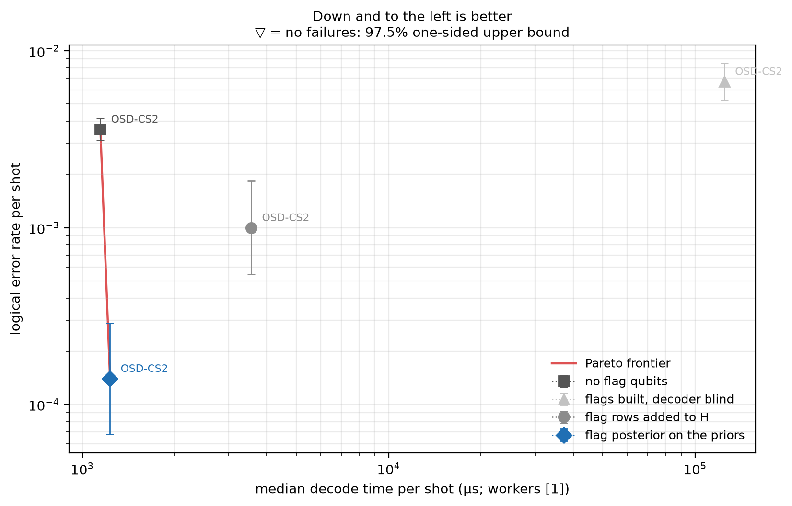
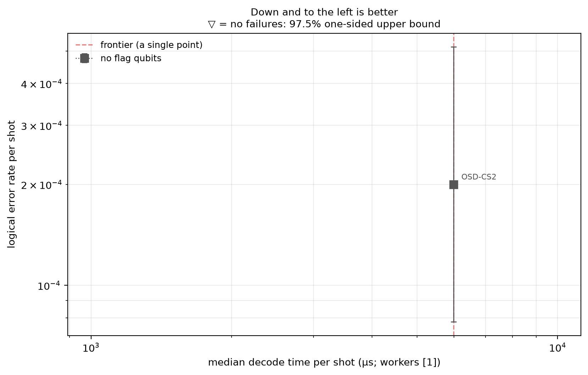

# Experiment 7 — accuracy–latency frontier (Table 5.9)

Data file: `E07_144-12-12+72-12-6_T12_p0.001_80000shots_seed2026110801_detZ_arms-unflagged-blind-sighted-updated_dec-OSD-CS2_cfg3aead44b.json` (sha256 `d2b5fe64b7f815e9d997bcf69822a494c620a2104e41ab6ae695a31218694824`)  
Run started: 2026-10-29T15:35:37 · status: complete  
Exported: 2026-10-29T17:30:14 by code 5c623b1e4691  
Export type: fresh run

## Table: table_5_9_72-12-6

[table_5_9_72-12-6.csv](table_5_9_72-12-6.csv) — 4 rows

| failures | ler | ci_low | ci_high | time_p50_us | time_p99_us | time_mean_us | time_update_p50_us | time_decode_p50_us | bp_iters_mean | detectors | faults | qubits_used | qubit_index_span | dem_sha256 | circuit_sha256 | workers_effective | backend | resumed_chunks | total_chunks | checkpoint_dir | timing_note | sample_sha256 | seed | arm | decoder | code | p | shots | osd_order | config_id |
|---|---|---|---|---|---|---|---|---|---|---|---|---|---|---|---|---|---|---|---|---|---|---|---|---|---|---|---|---|---|---|
| 180 | 0.0036 | 0.003112 | 0.004164 | 1146 | 1.064e+05 | 2.151e+04 | 0 | 1146 | 11.52 | 468 | 4392 | 144 | 144 | 4a7bed7721b9ddd6eb46f5f6cad843f1eac38f29eb8e821f0379b76efeeba1c8 | dd07c7903cab9542fb94b2eefa30bad705e38b2c34d1009c03a7ad7d0f1b1cda | 1 | single-process loop, arms in turns per chunk (rotating order); checkpoint C:\Users\user\Desktop\Thesis\Flag-Triggered-Switching\results\checkpoints\E07_144-12-12+72-12-6_T12_p0.001_80000shots_seed2026110801_detZ_arms-unflagged-blind-sighted-updated_dec-OSD-CS2_cfg3aead44b\72-12-6_T12_p0.001_s0_OSD-CS2\interleaved_OSD-CS2 | 0 | 200 | C:\Users\user\Desktop\Thesis\Flag-Triggered-Switching\results\checkpoints\E07_144-12-12+72-12-6_T12_p0.001_80000shots_seed2026110801_detZ_arms-unflagged-blind-sighted-updated_dec-OSD-CS2_cfg3aead44b\72-12-6_T12_p0.001_s0_OSD-CS2\interleaved_OSD-CS2 |  | d763198485aa2e1af9754fa97a0c1679b6e8ab4b2cfd0daa6f3135883bc21c72 | 150884214700264012 | unflagged | OSD-CS2 | [[72, 12, 6]] | 0.001 | 50000 | 2 | 72-12-6_T12_p0.001_s0_OSD-CS2 |
| 7 | 0.00014 | 6.782e-05 | 0.000289 | 1232 | 1.335e+05 | 5705 | 365.2 | 757.1 | 4.2 | 468 | 5688 | 180 | 180 | 5ec9aedf825acc63d6e6edecb92291257e368f78fb69f21eb0e3936d54431bdf | f2f1bfa35e6724c1e09c8f393cdda7563523542ece80582078bbefbf418a8fe9 | 1 | single-process loop, arms in turns per chunk (rotating order); checkpoint C:\Users\user\Desktop\Thesis\Flag-Triggered-Switching\results\checkpoints\E07_144-12-12+72-12-6_T12_p0.001_80000shots_seed2026110801_detZ_arms-unflagged-blind-sighted-updated_dec-OSD-CS2_cfg3aead44b\72-12-6_T12_p0.001_s0_OSD-CS2\interleaved_OSD-CS2 | 0 | 200 | C:\Users\user\Desktop\Thesis\Flag-Triggered-Switching\results\checkpoints\E07_144-12-12+72-12-6_T12_p0.001_80000shots_seed2026110801_detZ_arms-unflagged-blind-sighted-updated_dec-OSD-CS2_cfg3aead44b\72-12-6_T12_p0.001_s0_OSD-CS2\interleaved_OSD-CS2 |  | 1355b141fa88f18a56395238125eb03fc35697081dca2111225c3f74b820eac6 | 1857614567325396710 | updated | OSD-CS2 | [[72, 12, 6]] | 0.001 | 50000 | 2 | 72-12-6_T12_p0.001_s0_OSD-CS2 |
| 67 | 0.0067 | 0.00528 | 0.008499 | 1.246e+05 | 2.07e+05 | 1.146e+05 | 0 | 1.246e+05 | 26.97 | 468 | 5688 | 180 | 180 | 5ec9aedf825acc63d6e6edecb92291257e368f78fb69f21eb0e3936d54431bdf | f2f1bfa35e6724c1e09c8f393cdda7563523542ece80582078bbefbf418a8fe9 | 1 | single-process loop, arms in turns per chunk (rotating order); checkpoint C:\Users\user\Desktop\Thesis\Flag-Triggered-Switching\results\checkpoints\E07_144-12-12+72-12-6_T12_p0.001_80000shots_seed2026110801_detZ_arms-unflagged-blind-sighted-updated_dec-OSD-CS2_cfg3aead44b\72-12-6_T12_p0.001_s0_OSD-CS2\interleaved_OSD-CS2 | 0 | 40 | C:\Users\user\Desktop\Thesis\Flag-Triggered-Switching\results\checkpoints\E07_144-12-12+72-12-6_T12_p0.001_80000shots_seed2026110801_detZ_arms-unflagged-blind-sighted-updated_dec-OSD-CS2_cfg3aead44b\72-12-6_T12_p0.001_s0_OSD-CS2\interleaved_OSD-CS2 |  | 5b6fe46e1770e77f564ce70fcf1c251be0d1614ef637b2d446073ded2de31ad7 | 1857614567325396710 | blind | OSD-CS2 | [[72, 12, 6]] | 0.001 | 10000 | 2 | 72-12-6_T12_p0.001_s0_OSD-CS2 |
| 10 | 0.001 | 0.0005433 | 0.00184 | 3563 | 1.88e+05 | 6.698e+04 | 0 | 3563 | 16.68 | 900 | 5688 | 180 | 180 | 5ec9aedf825acc63d6e6edecb92291257e368f78fb69f21eb0e3936d54431bdf | f2f1bfa35e6724c1e09c8f393cdda7563523542ece80582078bbefbf418a8fe9 | 1 | single-process loop, arms in turns per chunk (rotating order); checkpoint C:\Users\user\Desktop\Thesis\Flag-Triggered-Switching\results\checkpoints\E07_144-12-12+72-12-6_T12_p0.001_80000shots_seed2026110801_detZ_arms-unflagged-blind-sighted-updated_dec-OSD-CS2_cfg3aead44b\72-12-6_T12_p0.001_s0_OSD-CS2\interleaved_OSD-CS2 | 0 | 40 | C:\Users\user\Desktop\Thesis\Flag-Triggered-Switching\results\checkpoints\E07_144-12-12+72-12-6_T12_p0.001_80000shots_seed2026110801_detZ_arms-unflagged-blind-sighted-updated_dec-OSD-CS2_cfg3aead44b\72-12-6_T12_p0.001_s0_OSD-CS2\interleaved_OSD-CS2 |  | 5b6fe46e1770e77f564ce70fcf1c251be0d1614ef637b2d446073ded2de31ad7 | 1857614567325396710 | sighted | OSD-CS2 | [[72, 12, 6]] | 0.001 | 10000 | 2 | 72-12-6_T12_p0.001_s0_OSD-CS2 |

## Table: table_5_9_144-12-12

[table_5_9_144-12-12.csv](table_5_9_144-12-12.csv) — 1 rows

| failures | ler | ci_low | ci_high | time_p50_us | time_p99_us | time_mean_us | time_update_p50_us | time_decode_p50_us | bp_iters_mean | detectors | faults | qubits_used | qubit_index_span | dem_sha256 | circuit_sha256 | workers_effective | backend | resumed_chunks | total_chunks | checkpoint_dir | timing_note | sample_sha256 | seed | arm | decoder | code | p | shots | osd_order | config_id |
|---|---|---|---|---|---|---|---|---|---|---|---|---|---|---|---|---|---|---|---|---|---|---|---|---|---|---|---|---|---|---|
| 4 | 0.0002 | 7.778e-05 | 0.0005142 | 5982 | 5.334e+05 | 1.821e+05 | 0 | 5982 | 17.84 | 936 | 8784 | 288 | 288 | b591a040b1c0bd1230189eec5e4d9f758d5736c17f29cc5fb28adb64f895acea | 5a5784f14b7a3b5fc5827c803b39676675eb1bdf52dd59a08da6478f0b9e4a8c | 1 | sequential; checkpoint C:\Users\user\Desktop\Thesis\Flag-Triggered-Switching\results\checkpoints\E07_144-12-12+72-12-6_T12_p0.001_80000shots_seed2026110801_detZ_arms-unflagged-blind-sighted-updated_dec-OSD-CS2_cfg3aead44b\144-12-12_T12_p0.001_s0_OSD-CS2\unflagged_OSD-CS2 | 0 | 80 | C:\Users\user\Desktop\Thesis\Flag-Triggered-Switching\results\checkpoints\E07_144-12-12+72-12-6_T12_p0.001_80000shots_seed2026110801_detZ_arms-unflagged-blind-sighted-updated_dec-OSD-CS2_cfg3aead44b\144-12-12_T12_p0.001_s0_OSD-CS2\unflagged_OSD-CS2 |  | bde0ecf7d2ecfc8d406f7d9a3a7820d631ec2e05ff281cb6ed06b5e23cbb235a | 4147278579613826204 | unflagged | OSD-CS2 | [[144, 12, 12]] | 0.001 | 20000 | 2 | 144-12-12_T12_p0.001_s0_OSD-CS2 |

## Figure: frontier_72-12-6

  
Vector version: [frontier_72-12-6.pdf](frontier_72-12-6.pdf)

## Figure: frontier_144-12-12

  
Vector version: [frontier_144-12-12.pdf](frontier_144-12-12.pdf)
