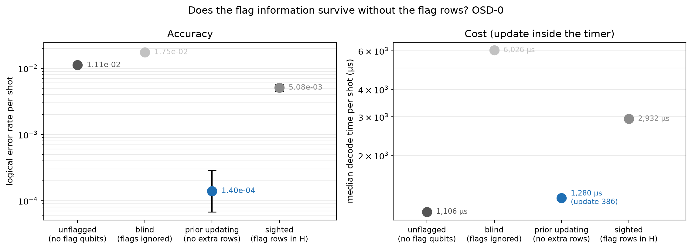
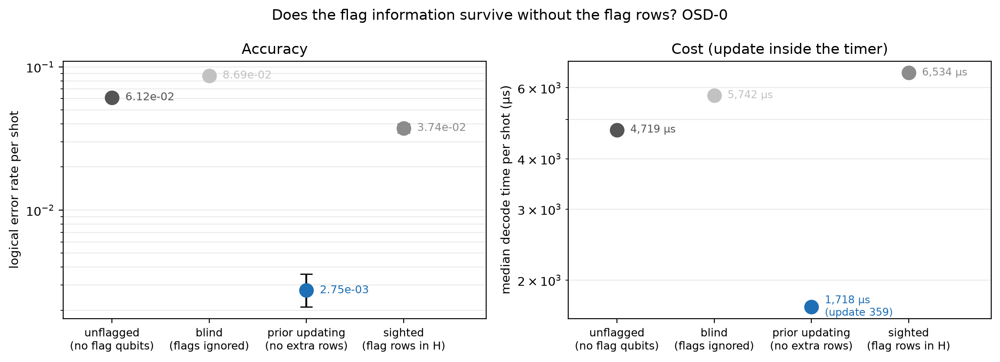
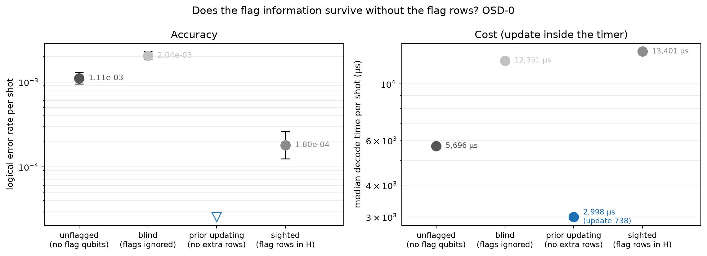
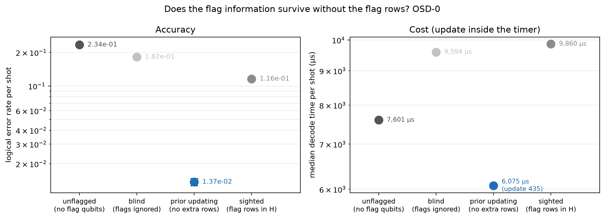
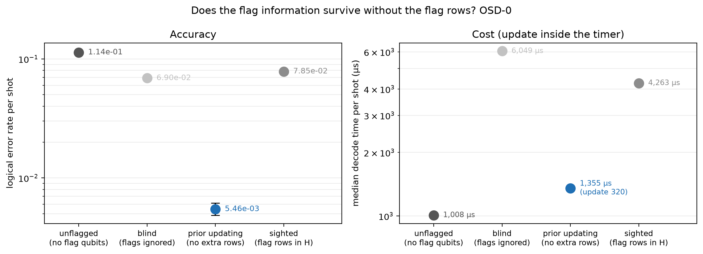
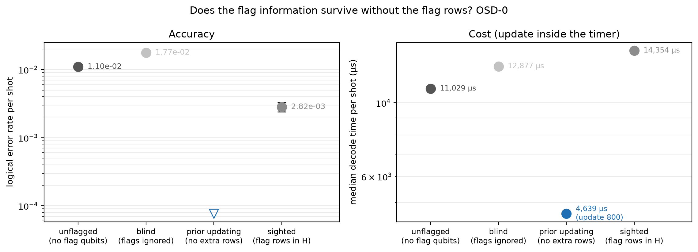

# Experiment 8 — prior updating (Table 5.8)

Data file: `E08_4codes_T12_p0.001-0.002x2_390000shots_seed2026110801_detZ_arms-unflagged-blind-sighted-updated_dec-OSD-0+OSD-CS4_cfg5460cab5.json` (sha256 `be49882edbbed166b11dd10064f5a1c8a6ebdbc20a6e4f37ecaa6244cf2129a5`)  
Run started: 2026-10-29T17:37:03 · status: complete  
Exported: 2026-10-29T20:59:50 by code 5c623b1e4691  
Export type: fresh run

## Table: table_5_8

[table_5_8.csv](table_5_8.csv) — 7 rows

| code | p | shots | decoder | tag | unflagged_failures | unflagged_ler | unflagged_p50_us | unflagged_p99_us | unflagged_iters | blind_failures | blind_ler | blind_p50_us | blind_p99_us | blind_iters | sighted_failures | sighted_ler | sighted_p50_us | sighted_p99_us | sighted_iters | updated_failures | updated_ler | updated_p50_us | updated_p99_us | updated_iters | blind|sighted_split | blind|sighted_p | sighted|updated_split | sighted|updated_p | blind|updated_split | blind|updated_p |
|---|---|---|---|---|---|---|---|---|---|---|---|---|---|---|---|---|---|---|---|---|---|---|---|---|---|---|---|---|---|---|
| [[72, 12, 6]] | 0.001 | 50000 | OSD-0 | None | 557 | 0.01114 | 1106 | 7250 | 11.52 | 873 | 0.01746 | 6026 | 9184 | 27 | 254 | 0.00508 | 2932 | 9712 | 16.6 | 7 | 0.00014 | 1280 | 7280 | 4.2 | 709:90 | 4.276e-120 | 249:2 | 1.748e-71 | 869:3 | 7.019e-255 |
| [[72, 12, 6]] | 0.002 | 20000 | OSD-0 | None | 1224 | 0.0612 | 4719 | 8512 | 20.93 | 1738 | 0.0869 | 5742 | 1.022e+04 | 24.61 | 748 | 0.0374 | 6534 | 1.091e+04 | 23.72 | 55 | 0.00275 | 1718 | 7920 | 9.063 | 1240:250 | 1.06e-157 | 708:15 | 2.359e-187 | 1699:16 | 0 |
| [[144, 12, 12]] | 0.001 | 150000 | OSD-0 | None | 166 | 0.001107 | 5696 | 1.446e+04 | 17.88 | 306 | 0.00204 | 1.235e+04 | 1.773e+04 | 29.66 | 27 | 0.00018 | 1.34e+04 | 1.889e+04 | 23.5 | 0 | 0 | 2998 | 1.493e+04 | 6.299 | 296:17 | 6.098e-67 | 27:0 | 1.49e-08 | 306:0 | 1.534e-92 |
| [[46, 2, 9]] | 0.001 | 50000 | OSD-0 | None | 11718 | 0.2344 | 7601 | 2.227e+04 | 20.24 | 9106 | 0.1821 | 9594 | 2.798e+04 | 26.06 | 5792 | 0.1158 | 9860 | 3.284e+04 | 24.33 | 685 | 0.0137 | 6075 | 1.75e+04 | 19.03 | 6544:3230 | 4.235e-251 | 5384:277 | 0 | 8681:260 | 0 |
| [[48, 6, 8]] | 0.001 | 50000 | OSD-0 | None | 5676 | 0.1135 | 1008 | 9107 | 11.47 | 3450 | 0.069 | 6049 | 1.137e+04 | 24.3 | 3925 | 0.0785 | 4263 | 1.28e+04 | 17.52 | 273 | 0.00546 | 1355 | 8916 | 8.218 | 2086:2561 | 3.421e-12 | 3759:107 | 0 | 3289:112 | 0 |
| [[46, 2, 9]] | 0.001 | 20000 | OSD-CS4 | None | 1351 | 0.06755 | 8.028e+04 | 2.465e+05 | 20.29 |  |  |  |  |  |  |  |  |  |  |  |  |  |  |  |  |  |  |  |  |  |
| [[144, 12, 12]] | 0.002 | 50000 | OSD-0 | None | 548 | 0.01096 | 1.103e+04 | 1.859e+04 | 26.97 | 886 | 0.01772 | 1.288e+04 | 2.365e+04 | 28.76 | 141 | 0.00282 | 1.435e+04 | 2.282e+04 | 28.54 | 0 | 0 | 4639 | 1.7e+04 | 13.41 | 810:65 | 1.554e-164 | 141:0 | 7.175e-43 | 886:0 | 3.877e-267 |

## Table: arms

[arms.csv](arms.csv) — 25 rows

| code | rounds | p | shots | shard | decoder | arm | failures | ler | ci_low | ci_high | time_p50_us | time_p99_us | time_mean_us | time_update_p50_us | bp_iters_mean | detectors | qubits_used | workers | resumed_chunks | seed |
|---|---|---|---|---|---|---|---|---|---|---|---|---|---|---|---|---|---|---|---|---|
| [[72, 12, 6]] | 12 | 0.001 | 50000 | 0 | OSD-0 | unflagged | 557 | 0.01114 | 0.01026 | 0.0121 | 1106 | 7250 | 2208 | 0 | 11.52 | 468 | 144 | 1 | 0 | 150884214700264012 |
| [[72, 12, 6]] | 12 | 0.001 | 50000 | 0 | OSD-0 | blind | 873 | 0.01746 | 0.01635 | 0.01865 | 6026 | 9184 | 5735 | 0 | 27 | 468 | 180 | 1 | 0 | 1857614567325396710 |
| [[72, 12, 6]] | 12 | 0.001 | 50000 | 0 | OSD-0 | sighted | 254 | 0.00508 | 0.004494 | 0.005742 | 2932 | 9712 | 4177 | 0 | 16.6 | 900 | 180 | 1 | 0 | 1857614567325396710 |
| [[72, 12, 6]] | 12 | 0.001 | 50000 | 0 | OSD-0 | updated | 7 | 0.00014 | 6.782e-05 | 0.000289 | 1280 | 7280 | 1585 | 385.9 | 4.2 | 468 | 180 | 1 | 0 | 1857614567325396710 |
| [[72, 12, 6]] | 12 | 0.002 | 20000 | 0 | OSD-0 | unflagged | 1224 | 0.0612 | 0.05796 | 0.06461 | 4719 | 8512 | 3853 | 0 | 20.93 | 468 | 144 | 1 | 0 | 7147977199058986535 |
| [[72, 12, 6]] | 12 | 0.002 | 20000 | 0 | OSD-0 | blind | 1738 | 0.0869 | 0.08307 | 0.09088 | 5742 | 1.022e+04 | 5261 | 0 | 24.61 | 468 | 180 | 1 | 0 | 4105339059150540127 |
| [[72, 12, 6]] | 12 | 0.002 | 20000 | 0 | OSD-0 | sighted | 748 | 0.0374 | 0.03486 | 0.04012 | 6534 | 1.091e+04 | 5745 | 0 | 23.72 | 900 | 180 | 1 | 0 | 4105339059150540127 |
| [[72, 12, 6]] | 12 | 0.002 | 20000 | 0 | OSD-0 | updated | 55 | 0.00275 | 0.002114 | 0.003577 | 1718 | 7920 | 2328 | 359.1 | 9.063 | 468 | 180 | 1 | 0 | 4105339059150540127 |
| [[144, 12, 12]] | 12 | 0.001 | 150000 | 0 | OSD-0 | unflagged | 166 | 0.001107 | 0.0009507 | 0.001288 | 5696 | 1.446e+04 | 6702 | 0 | 17.88 | 936 | 288 | 1 | 0 | 4147278579613826204 |
| [[144, 12, 12]] | 12 | 0.001 | 150000 | 0 | OSD-0 | blind | 306 | 0.00204 | 0.001824 | 0.002281 | 1.235e+04 | 1.773e+04 | 1.266e+04 | 0 | 29.66 | 936 | 360 | 1 | 0 | 8252477738678029781 |
| [[144, 12, 12]] | 12 | 0.001 | 150000 | 0 | OSD-0 | sighted | 27 | 0.00018 | 0.0001237 | 0.0002619 | 1.34e+04 | 1.889e+04 | 1.129e+04 | 0 | 23.5 | 1800 | 360 | 1 | 0 | 8252477738678029781 |
| [[144, 12, 12]] | 12 | 0.001 | 150000 | 0 | OSD-0 | updated | 0 | 0 | 0 | 2.561e-05 | 2998 | 1.493e+04 | 3806 | 738.1 | 6.299 | 936 | 360 | 1 | 0 | 8252477738678029781 |
| [[46, 2, 9]] | 12 | 0.001 | 50000 | 0 | OSD-0 | unflagged | 11718 | 0.2344 | 0.2307 | 0.2381 | 7601 | 2.227e+04 | 7174 | 0 | 20.24 | 299 | 92 | 1 | 0 | 1457647478641513166 |
| [[46, 2, 9]] | 12 | 0.001 | 50000 | 0 | OSD-0 | blind | 9106 | 0.1821 | 0.1788 | 0.1855 | 9594 | 2.798e+04 | 1.018e+04 | 0 | 26.06 | 299 | 115 | 1 | 0 | 847957916683292647 |
| [[46, 2, 9]] | 12 | 0.001 | 50000 | 0 | OSD-0 | sighted | 5792 | 0.1158 | 0.1131 | 0.1187 | 9860 | 3.284e+04 | 1.014e+04 | 0 | 24.33 | 575 | 115 | 1 | 0 | 847957916683292647 |
| [[46, 2, 9]] | 12 | 0.001 | 50000 | 0 | OSD-0 | updated | 685 | 0.0137 | 0.01272 | 0.01476 | 6075 | 1.75e+04 | 6697 | 435.2 | 19.03 | 299 | 115 | 1 | 0 | 847957916683292647 |
| [[48, 6, 8]] | 12 | 0.001 | 50000 | 0 | OSD-0 | unflagged | 5676 | 0.1135 | 0.1108 | 0.1163 | 1008 | 9107 | 2455 | 0 | 11.47 | 312 | 96 | 1 | 0 | 3304096851785146954 |
| [[48, 6, 8]] | 12 | 0.001 | 50000 | 0 | OSD-0 | blind | 3450 | 0.069 | 0.06681 | 0.07125 | 6049 | 1.137e+04 | 5520 | 0 | 24.3 | 312 | 120 | 1 | 0 | 5124275214818371070 |
| [[48, 6, 8]] | 12 | 0.001 | 50000 | 0 | OSD-0 | sighted | 3925 | 0.0785 | 0.07617 | 0.08089 | 4263 | 1.28e+04 | 4594 | 0 | 17.52 | 600 | 120 | 1 | 0 | 5124275214818371070 |
| [[48, 6, 8]] | 12 | 0.001 | 50000 | 0 | OSD-0 | updated | 273 | 0.00546 | 0.004851 | 0.006145 | 1355 | 8916 | 2317 | 320.2 | 8.218 | 312 | 120 | 1 | 0 | 5124275214818371070 |
| [[46, 2, 9]] | 12 | 0.001 | 20000 | 0 | OSD-CS4 | unflagged | 1351 | 0.06755 | 0.06415 | 0.07111 | 8.028e+04 | 2.465e+05 | 5.71e+04 | 0 | 20.29 | 299 | 92 | 1 | 0 | 1457647478641513166 |
| [[144, 12, 12]] | 12 | 0.002 | 50000 | 0 | OSD-0 | unflagged | 548 | 0.01096 | 0.01008 | 0.01191 | 1.103e+04 | 1.859e+04 | 1.052e+04 | 0 | 26.97 | 936 | 288 | 1 | 0 | 2925857495378747486 |
| [[144, 12, 12]] | 12 | 0.002 | 50000 | 0 | OSD-0 | blind | 886 | 0.01772 | 0.0166 | 0.01891 | 1.288e+04 | 2.365e+04 | 1.31e+04 | 0 | 28.76 | 936 | 360 | 1 | 0 | 4873672771939772957 |
| [[144, 12, 12]] | 12 | 0.002 | 50000 | 0 | OSD-0 | sighted | 141 | 0.00282 | 0.002392 | 0.003325 | 1.435e+04 | 2.282e+04 | 1.431e+04 | 0 | 28.54 | 1800 | 360 | 1 | 0 | 4873672771939772957 |
| [[144, 12, 12]] | 12 | 0.002 | 50000 | 0 | OSD-0 | updated | 0 | 0 | 0 | 7.683e-05 | 4639 | 1.7e+04 | 6576 | 800.4 | 13.41 | 936 | 360 | 1 | 0 | 4873672771939772957 |

## Table: comparisons

[comparisons.csv](comparisons.csv) — 36 rows

| code | rounds | p | shots | decoder | comparison | paired | a_only | b_only | ratio | lo | hi | p_value | method |
|---|---|---|---|---|---|---|---|---|---|---|---|---|---|
| [[72, 12, 6]] | 12 | 0.001 | 50000 | OSD-0 | blind|sighted | True | 709 | 90 | 3.437 | None | None | 4.276e-120 | exact McNemar (two-sided) |
| [[72, 12, 6]] | 12 | 0.001 | 50000 | OSD-0 | sighted|updated | True | 249 | 2 | 36.29 | None | None | 1.748e-71 | exact McNemar (two-sided) |
| [[72, 12, 6]] | 12 | 0.001 | 50000 | OSD-0 | blind|updated | True | 869 | 3 | 124.7 | None | None | 7.019e-255 | exact McNemar (two-sided) |
| [[72, 12, 6]] | 12 | 0.001 | 50000 | OSD-0 | sighted|unflagged | False | None | None | 0.456 | 0.3916 | 0.5299 | 7.153e-27 | exact conditional (Clopper-Pearson on k1 | k1+k0) |
| [[72, 12, 6]] | 12 | 0.001 | 50000 | OSD-0 | blind|unflagged | False | None | None | 1.567 | 1.408 | 1.746 | 6.076e-17 | exact conditional (Clopper-Pearson on k1 | k1+k0) |
| [[72, 12, 6]] | 12 | 0.001 | 50000 | OSD-0 | updated|unflagged | False | None | None | 0.01257 | 0.005029 | 0.02607 | 1.164e-154 | exact conditional (Clopper-Pearson on k1 | k1+k0) |
| [[72, 12, 6]] | 12 | 0.002 | 20000 | OSD-0 | blind|sighted | True | 1240 | 250 | 2.324 | None | None | 1.06e-157 | exact McNemar (two-sided) |
| [[72, 12, 6]] | 12 | 0.002 | 20000 | OSD-0 | sighted|updated | True | 708 | 15 | 13.6 | None | None | 2.359e-187 | exact McNemar (two-sided) |
| [[72, 12, 6]] | 12 | 0.002 | 20000 | OSD-0 | blind|updated | True | 1699 | 16 | 31.6 | None | None | 0 | exact McNemar (two-sided) |
| [[72, 12, 6]] | 12 | 0.002 | 20000 | OSD-0 | sighted|unflagged | False | None | None | 0.6111 | 0.5572 | 0.6699 | 6.002e-27 | exact conditional (Clopper-Pearson on k1 | k1+k0) |
| [[72, 12, 6]] | 12 | 0.002 | 20000 | OSD-0 | blind|unflagged | False | None | None | 1.42 | 1.319 | 1.529 | 3.405e-21 | exact conditional (Clopper-Pearson on k1 | k1+k0) |
| [[72, 12, 6]] | 12 | 0.002 | 20000 | OSD-0 | updated|unflagged | False | None | None | 0.04493 | 0.03365 | 0.05888 | 3.683e-288 | exact conditional (Clopper-Pearson on k1 | k1+k0) |
| [[144, 12, 12]] | 12 | 0.001 | 150000 | OSD-0 | blind|sighted | True | 296 | 17 | 11.33 | None | None | 6.098e-67 | exact McNemar (two-sided) |
| [[144, 12, 12]] | 12 | 0.001 | 150000 | OSD-0 | sighted|updated | True | 27 | 0 | inf | None | None | 1.49e-08 | exact McNemar (two-sided) |
| [[144, 12, 12]] | 12 | 0.001 | 150000 | OSD-0 | blind|updated | True | 306 | 0 | inf | None | None | 1.534e-92 | exact McNemar (two-sided) |
| [[144, 12, 12]] | 12 | 0.001 | 150000 | OSD-0 | sighted|unflagged | False | None | None | 0.1627 | 0.1041 | 0.2453 | 1.326e-25 | exact conditional (Clopper-Pearson on k1 | k1+k0) |
| [[144, 12, 12]] | 12 | 0.001 | 150000 | OSD-0 | blind|unflagged | False | None | None | 1.843 | 1.521 | 2.24 | 1.159e-10 | exact conditional (Clopper-Pearson on k1 | k1+k0) |
| [[144, 12, 12]] | 12 | 0.001 | 150000 | OSD-0 | updated|unflagged | False | None | None | 0 | 0 | 0.02247 | 2.138e-50 | exact conditional (Clopper-Pearson on k1 | k1+k0) |
| [[46, 2, 9]] | 12 | 0.001 | 50000 | OSD-0 | blind|sighted | True | 6544 | 3230 | 1.572 | None | None | 4.235e-251 | exact McNemar (two-sided) |
| [[46, 2, 9]] | 12 | 0.001 | 50000 | OSD-0 | sighted|updated | True | 5384 | 277 | 8.455 | None | None | 0 | exact McNemar (two-sided) |
| [[46, 2, 9]] | 12 | 0.001 | 50000 | OSD-0 | blind|updated | True | 8681 | 260 | 13.29 | None | None | 0 | exact McNemar (two-sided) |
| [[46, 2, 9]] | 12 | 0.001 | 50000 | OSD-0 | sighted|unflagged | False | None | None | 0.4943 | 0.4789 | 0.5101 | 0 | exact conditional (Clopper-Pearson on k1 | k1+k0) |
| [[46, 2, 9]] | 12 | 0.001 | 50000 | OSD-0 | blind|unflagged | False | None | None | 0.7771 | 0.756 | 0.7987 | 2.325e-73 | exact conditional (Clopper-Pearson on k1 | k1+k0) |
| [[46, 2, 9]] | 12 | 0.001 | 50000 | OSD-0 | updated|unflagged | False | None | None | 0.05846 | 0.05404 | 0.06314 | 0 | exact conditional (Clopper-Pearson on k1 | k1+k0) |
| [[48, 6, 8]] | 12 | 0.001 | 50000 | OSD-0 | blind|sighted | True | 2086 | 2561 | 0.879 | None | None | 3.421e-12 | exact McNemar (two-sided) |
| [[48, 6, 8]] | 12 | 0.001 | 50000 | OSD-0 | sighted|updated | True | 3759 | 107 | 14.38 | None | None | 0 | exact McNemar (two-sided) |
| [[48, 6, 8]] | 12 | 0.001 | 50000 | OSD-0 | blind|updated | True | 3289 | 112 | 12.64 | None | None | 0 | exact McNemar (two-sided) |
| [[48, 6, 8]] | 12 | 0.001 | 50000 | OSD-0 | sighted|unflagged | False | None | None | 0.6915 | 0.6638 | 0.7204 | 9.885e-72 | exact conditional (Clopper-Pearson on k1 | k1+k0) |
| [[48, 6, 8]] | 12 | 0.001 | 50000 | OSD-0 | blind|unflagged | False | None | None | 0.6078 | 0.5825 | 0.6342 | 3.478e-121 | exact conditional (Clopper-Pearson on k1 | k1+k0) |
| [[48, 6, 8]] | 12 | 0.001 | 50000 | OSD-0 | updated|unflagged | False | None | None | 0.0481 | 0.04244 | 0.05432 | 0 | exact conditional (Clopper-Pearson on k1 | k1+k0) |
| [[144, 12, 12]] | 12 | 0.002 | 50000 | OSD-0 | blind|sighted | True | 810 | 65 | 6.284 | None | None | 1.554e-164 | exact McNemar (two-sided) |
| [[144, 12, 12]] | 12 | 0.002 | 50000 | OSD-0 | sighted|updated | True | 141 | 0 | inf | None | None | 7.175e-43 | exact McNemar (two-sided) |
| [[144, 12, 12]] | 12 | 0.002 | 50000 | OSD-0 | blind|updated | True | 886 | 0 | inf | None | None | 3.877e-267 | exact McNemar (two-sided) |
| [[144, 12, 12]] | 12 | 0.002 | 50000 | OSD-0 | sighted|unflagged | False | None | None | 0.2573 | 0.2123 | 0.3102 | 1.726e-57 | exact conditional (Clopper-Pearson on k1 | k1+k0) |
| [[144, 12, 12]] | 12 | 0.002 | 50000 | OSD-0 | blind|unflagged | False | None | None | 1.617 | 1.452 | 1.802 | 3.872e-19 | exact conditional (Clopper-Pearson on k1 | k1+k0) |
| [[144, 12, 12]] | 12 | 0.002 | 50000 | OSD-0 | updated|unflagged | False | None | None | 0 | 0 | 0.006754 | 2.171e-165 | exact conditional (Clopper-Pearson on k1 | k1+k0) |

## Figure: arms_72-12-6_T12_p0.001_s0_OSD-0

  
Vector version: [arms_72-12-6_T12_p0.001_s0_OSD-0.pdf](arms_72-12-6_T12_p0.001_s0_OSD-0.pdf)

## Figure: arms_72-12-6_T12_p0.002_s0_OSD-0

  
Vector version: [arms_72-12-6_T12_p0.002_s0_OSD-0.pdf](arms_72-12-6_T12_p0.002_s0_OSD-0.pdf)

## Figure: arms_144-12-12_T12_p0.001_s0_OSD-0

  
Vector version: [arms_144-12-12_T12_p0.001_s0_OSD-0.pdf](arms_144-12-12_T12_p0.001_s0_OSD-0.pdf)

## Figure: arms_46-2-9_T12_p0.001_s0_OSD-0

  
Vector version: [arms_46-2-9_T12_p0.001_s0_OSD-0.pdf](arms_46-2-9_T12_p0.001_s0_OSD-0.pdf)

## Figure: arms_48-6-8_T12_p0.001_s0_OSD-0

  
Vector version: [arms_48-6-8_T12_p0.001_s0_OSD-0.pdf](arms_48-6-8_T12_p0.001_s0_OSD-0.pdf)

## Figure: arms_144-12-12_T12_p0.002_s0_OSD-0

  
Vector version: [arms_144-12-12_T12_p0.002_s0_OSD-0.pdf](arms_144-12-12_T12_p0.002_s0_OSD-0.pdf)
