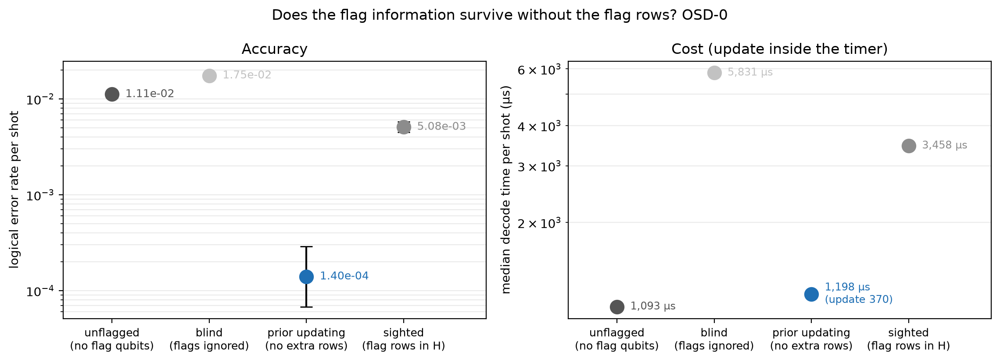
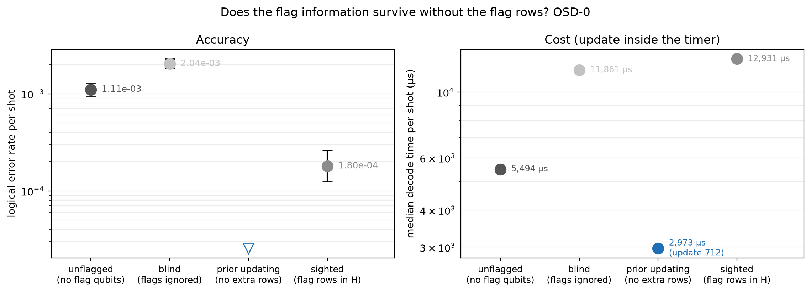
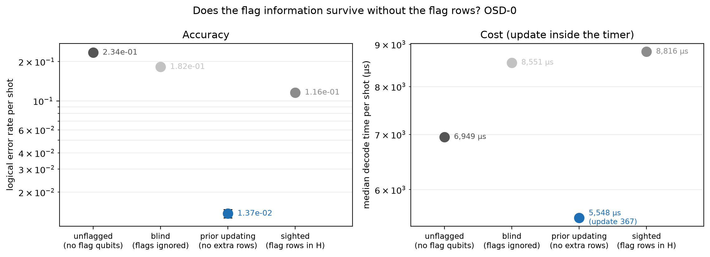
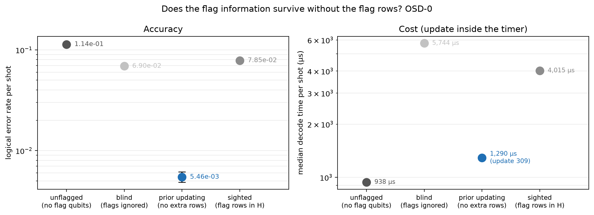
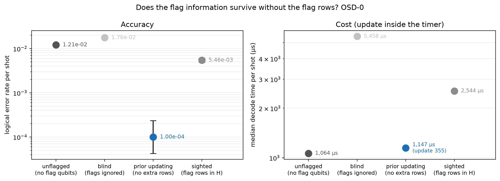
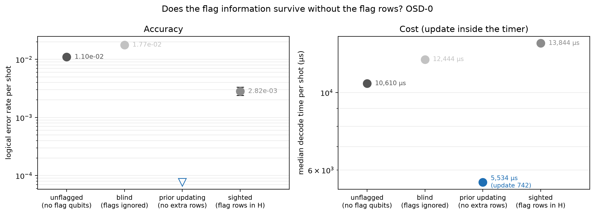
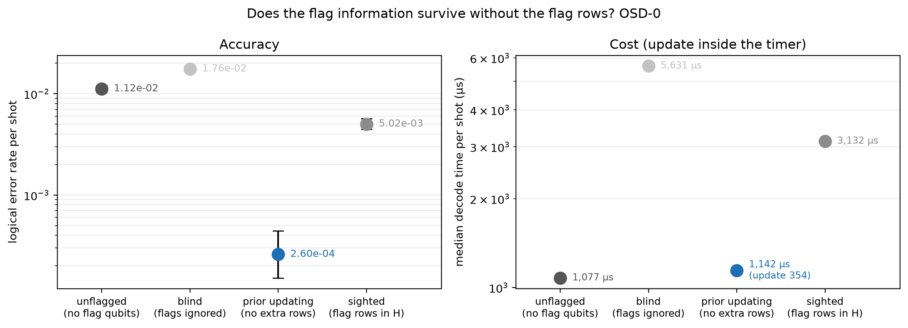
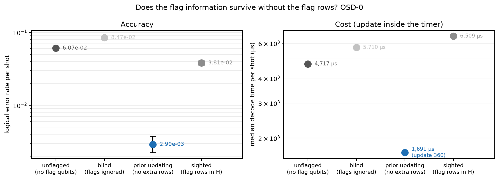
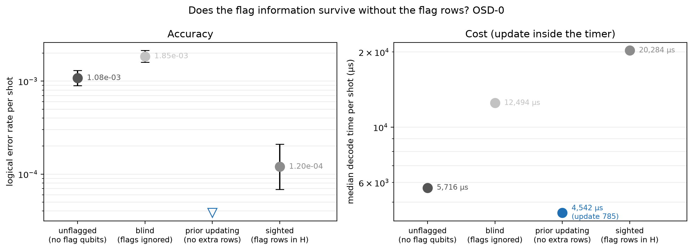

# Experiment 8 — prior updating (Table 5.8)

Data file: `E08_4codes_T12_p0.001-0.002x2_610000shots_seed2026110801_detZ_arms-unflagged-blind-sighted-updated_dec-OSD-0+OSD-CS4_cfgded46303.json` (sha256 `542ce69596fba0893c36d16ce59feb9c849bcc0b998b1020c7b8849f2cf4bf15`)  
Run started: 2026-10-30T16:24:30 · status: complete  
Exported: 2026-10-30T21:19:40 by code 02fb0b1d224b  
Export type: fresh run

## Table: table_5_8

[table_5_8.csv](table_5_8.csv) — 11 rows

| code | p | shots | decoder | tag | unflagged_failures | unflagged_ler | unflagged_p50_us | unflagged_p99_us | unflagged_iters | blind_failures | blind_ler | blind_p50_us | blind_p99_us | blind_iters | sighted_failures | sighted_ler | sighted_p50_us | sighted_p99_us | sighted_iters | updated_failures | updated_ler | updated_p50_us | updated_p99_us | updated_iters | blind|sighted_split | blind|sighted_p | sighted|updated_split | sighted|updated_p | blind|updated_split | blind|updated_p |
|---|---|---|---|---|---|---|---|---|---|---|---|---|---|---|---|---|---|---|---|---|---|---|---|---|---|---|---|---|---|---|
| [[72, 12, 6]] | 0.001 | 50000 | OSD-0 | None | 557 | 0.01114 | 1093 | 7040 | 11.52 | 873 | 0.01746 | 5831 | 8702 | 27 | 254 | 0.00508 | 3458 | 1.258e+04 | 16.6 | 7 | 0.00014 | 1198 | 6745 | 4.2 | 709:90 | 4.276e-120 | 249:2 | 1.748e-71 | 869:3 | 7.019e-255 |
| [[72, 12, 6]] | 0.002 | 20000 | OSD-0 | None | 1224 | 0.0612 | 4814 | 8565 | 20.93 | 1738 | 0.0869 | 5844 | 1.039e+04 | 24.61 | 748 | 0.0374 | 6656 | 1.117e+04 | 23.72 | 55 | 0.00275 | 1732 | 8063 | 9.063 | 1240:250 | 1.06e-157 | 708:15 | 2.359e-187 | 1699:16 | 0 |
| [[144, 12, 12]] | 0.001 | 150000 | OSD-0 | None | 166 | 0.001107 | 5494 | 1.422e+04 | 17.88 | 306 | 0.00204 | 1.186e+04 | 1.758e+04 | 29.66 | 27 | 0.00018 | 1.293e+04 | 1.876e+04 | 23.5 | 0 | 0 | 2973 | 1.449e+04 | 6.299 | 296:17 | 6.098e-67 | 27:0 | 1.49e-08 | 306:0 | 1.534e-92 |
| [[46, 2, 9]] | 0.001 | 50000 | OSD-0 | None | 11718 | 0.2344 | 6949 | 2.035e+04 | 20.24 | 9106 | 0.1821 | 8551 | 2.53e+04 | 26.06 | 5792 | 0.1158 | 8816 | 2.919e+04 | 24.33 | 685 | 0.0137 | 5548 | 1.581e+04 | 19.03 | 6544:3230 | 4.235e-251 | 5384:277 | 0 | 8681:260 | 0 |
| [[48, 6, 8]] | 0.001 | 50000 | OSD-0 | None | 5676 | 0.1135 | 938 | 8595 | 11.47 | 3450 | 0.069 | 5744 | 1.064e+04 | 24.3 | 3925 | 0.0785 | 4015 | 1.2e+04 | 17.52 | 273 | 0.00546 | 1290 | 8541 | 8.218 | 2086:2561 | 3.421e-12 | 3759:107 | 0 | 3289:112 | 0 |
| [[46, 2, 9]] | 0.001 | 20000 | OSD-CS4 | None | 1351 | 0.06755 | 7.669e+04 | 2.444e+05 | 20.29 |  |  |  |  |  |  |  |  |  |  |  |  |  |  |  |  |  |  |  |  |  |
| [[72, 12, 6]] (X basis) | 0.001 | 50000 | OSD-0 | xbasis | 605 | 0.0121 | 1064 | 6832 | 13.34 | 881 | 0.01762 | 5458 | 8284 | 27.06 | 273 | 0.00546 | 2544 | 8965 | 16.52 | 5 | 0.0001 | 1147 | 6445 | 4.153 | 698:90 | 2.337e-117 | 272:4 | 3.954e-75 | 879:3 | 7.093e-258 |
| [[144, 12, 12]] | 0.002 | 50000 | OSD-0 | None | 548 | 0.01096 | 1.061e+04 | 1.773e+04 | 26.97 | 886 | 0.01772 | 1.244e+04 | 2.31e+04 | 28.76 | 141 | 0.00282 | 1.384e+04 | 2.197e+04 | 28.54 | 0 | 0 | 5534 | 2.206e+04 | 13.41 | 810:65 | 1.554e-164 | 141:0 | 7.175e-43 | 886:0 | 3.877e-267 |
| [[72, 12, 6]] | 0.001 | 50000 | OSD-0 | seed2 | 559 | 0.01118 | 1077 | 6876 | 11.56 | 878 | 0.01756 | 5631 | 8539 | 27.17 | 251 | 0.00502 | 3132 | 9241 | 16.68 | 13 | 0.00026 | 1142 | 6549 | 4.232 | 735:108 | 2.274e-115 | 245:7 | 3.348e-63 | 870:5 | 3.374e-251 |
| [[72, 12, 6]] | 0.002 | 20000 | OSD-0 | seed2 | 1215 | 0.06075 | 4717 | 8219 | 20.91 | 1693 | 0.08465 | 5710 | 9766 | 24.66 | 761 | 0.03805 | 6509 | 1.022e+04 | 23.87 | 58 | 0.0029 | 1691 | 7787 | 9.084 | 1188:256 | 1.519e-143 | 726:23 | 2.488e-182 | 1656:21 | 0 |
| [[144, 12, 12]] | 0.001 | 100000 | OSD-0 | seed2 | 108 | 0.00108 | 5716 | 1.439e+04 | 17.9 | 185 | 0.00185 | 1.249e+04 | 1.765e+04 | 29.66 | 12 | 0.00012 | 2.028e+04 | 2.988e+04 | 23.54 | 0 | 0 | 4542 | 2.546e+04 | 6.255 | 184:11 | 1.233e-41 | 12:0 | 0.0004883 | 185:0 | 4.078e-56 |

## Table: arms

[arms.csv](arms.csv) — 41 rows

## Table: comparisons

[comparisons.csv](comparisons.csv) — 60 rows

## Table: x_basis_mirror

[x_basis_mirror.csv](x_basis_mirror.csv) — 4 rows

| code | p | arm | shots_x | shots_z | failures_x | failures_z | ratio | lo | hi | p_value |
|---|---|---|---|---|---|---|---|---|---|---|
| [[72, 12, 6]] | 0.001 | unflagged | 50000 | 50000 | 605 | 557 | 1.086 | 0.9665 | 1.221 | 0.1679 |
| [[72, 12, 6]] | 0.001 | blind | 50000 | 50000 | 881 | 873 | 1.009 | 0.9179 | 1.109 | 0.8673 |
| [[72, 12, 6]] | 0.001 | sighted | 50000 | 50000 | 273 | 254 | 1.075 | 0.9027 | 1.28 | 0.433 |
| [[72, 12, 6]] | 0.001 | updated | 50000 | 50000 | 5 | 7 | 0.7143 | 0.1788 | 2.614 | 0.7744 |

## Figure: arms_72-12-6_T12_p0.001_s0_OSD-0

  
Vector version: [arms_72-12-6_T12_p0.001_s0_OSD-0.pdf](arms_72-12-6_T12_p0.001_s0_OSD-0.pdf)

## Figure: arms_72-12-6_T12_p0.002_s0_OSD-0

  
Vector version: [arms_72-12-6_T12_p0.002_s0_OSD-0.pdf](arms_72-12-6_T12_p0.002_s0_OSD-0.pdf)

## Figure: arms_144-12-12_T12_p0.001_s0_OSD-0

  
Vector version: [arms_144-12-12_T12_p0.001_s0_OSD-0.pdf](arms_144-12-12_T12_p0.001_s0_OSD-0.pdf)

## Figure: arms_46-2-9_T12_p0.001_s0_OSD-0

  
Vector version: [arms_46-2-9_T12_p0.001_s0_OSD-0.pdf](arms_46-2-9_T12_p0.001_s0_OSD-0.pdf)

## Figure: arms_48-6-8_T12_p0.001_s0_OSD-0

  
Vector version: [arms_48-6-8_T12_p0.001_s0_OSD-0.pdf](arms_48-6-8_T12_p0.001_s0_OSD-0.pdf)

## Figure: arms_72-12-6_T12_p0.001_s0_OSD-0_xbasis

  
Vector version: [arms_72-12-6_T12_p0.001_s0_OSD-0_xbasis.pdf](arms_72-12-6_T12_p0.001_s0_OSD-0_xbasis.pdf)

## Figure: arms_144-12-12_T12_p0.002_s0_OSD-0

  
Vector version: [arms_144-12-12_T12_p0.002_s0_OSD-0.pdf](arms_144-12-12_T12_p0.002_s0_OSD-0.pdf)

## Figure: arms_72-12-6_T12_p0.001_s0_OSD-0_seed2

  
Vector version: [arms_72-12-6_T12_p0.001_s0_OSD-0_seed2.pdf](arms_72-12-6_T12_p0.001_s0_OSD-0_seed2.pdf)

## Figure: arms_72-12-6_T12_p0.002_s0_OSD-0_seed2

  
Vector version: [arms_72-12-6_T12_p0.002_s0_OSD-0_seed2.pdf](arms_72-12-6_T12_p0.002_s0_OSD-0_seed2.pdf)

## Figure: arms_144-12-12_T12_p0.001_s0_OSD-0_seed2

  
Vector version: [arms_144-12-12_T12_p0.001_s0_OSD-0_seed2.pdf](arms_144-12-12_T12_p0.001_s0_OSD-0_seed2.pdf)
