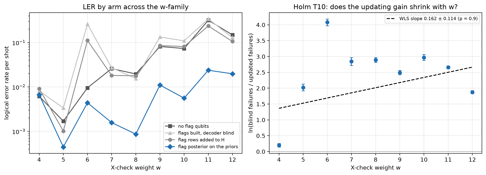

# Experiment 9 — check-weight family

Data file: `E09_9codes_T12_p0.0007_560000shots_seed2026110901_detZ_arms-unflagged-blind-sighted-updated_dec-OSD-0_cfgb2238803.json` (sha256 `fcab34492d8c74b6169fc5bdc5f5d1781d88fa2401d7d768db484c7da31b576f`)  
Run started: 2026-10-30T10:00:42 · status: complete  
Exported: 2026-10-30T10:58:24 by code 71f642656287  
Export type: fresh run

## Table: arms

[arms.csv](arms.csv) — 36 rows

| code | rounds | p | shots | shard | decoder | arm | failures | ler | ci_low | ci_high | time_p50_us | time_p99_us | time_mean_us | time_update_p50_us | bp_iters_mean | detectors | qubits_used | workers | resumed_chunks | seed |
|---|---|---|---|---|---|---|---|---|---|---|---|---|---|---|---|---|---|---|---|---|
| GB24 w=4 [[48, 6]] | 12 | 0.0007 | 20000 | 0 | OSD-0 | unflagged | 123 | 0.00615 | 0.005157 | 0.007332 | 260.2 | 1797 | 248.4 | 0 | 2.234 | 312 | 96 | 12 | 0 | 7285629587316558907 |
| GB24 w=4 [[48, 6]] | 12 | 0.0007 | 20000 | 0 | OSD-0 | blind | 164 | 0.0082 | 0.007041 | 0.009548 | 378.8 | 2628 | 392.1 | 0 | 2.668 | 312 | 120 | 12 | 0 | 8438483617880430140 |
| GB24 w=4 [[48, 6]] | 12 | 0.0007 | 20000 | 0 | OSD-0 | sighted | 183 | 0.00915 | 0.007921 | 0.01057 | 489.5 | 3137 | 530.9 | 0 | 3.314 | 600 | 120 | 12 | 0 | 8438483617880430140 |
| GB24 w=4 [[48, 6]] | 12 | 0.0007 | 20000 | 0 | OSD-0 | updated | 134 | 0.0067 | 0.00566 | 0.007929 | 374.7 | 1918 | 454.2 | 169.2 | 2.171 | 312 | 120 | 1 | 0 | 8438483617880430140 |
| GB24 w=5 [[48, 4]] | 12 | 0.0007 | 200000 | 0 | OSD-0 | unflagged | 340 | 0.0017 | 0.001529 | 0.00189 | 386 | 3553 | 659.7 | 0 | 5.144 | 312 | 96 | 12 | 0 | 8655322724974465734 |
| GB24 w=5 [[48, 4]] | 12 | 0.0007 | 200000 | 0 | OSD-0 | blind | 674 | 0.00337 | 0.003125 | 0.003634 | 647.3 | 4756 | 1712 | 0 | 12.67 | 312 | 120 | 12 | 0 | 6066873608845003413 |
| GB24 w=5 [[48, 4]] | 12 | 0.0007 | 200000 | 0 | OSD-0 | sighted | 203 | 0.001015 | 0.0008847 | 0.001164 | 679.6 | 5153 | 1150 | 0 | 6.051 | 600 | 120 | 12 | 0 | 6066873608845003413 |
| GB24 w=5 [[48, 4]] | 12 | 0.0007 | 200000 | 0 | OSD-0 | updated | 89 | 0.000445 | 0.0003617 | 0.0005475 | 485.4 | 2557 | 562.8 | 200.1 | 2.031 | 312 | 120 | 1 | 0 | 6066873608845003413 |
| GB24 w=6 [[48, 2]] | 12 | 0.0007 | 20000 | 0 | OSD-0 | unflagged | 191 | 0.00955 | 0.008293 | 0.011 | 585.3 | 4777 | 677 | 0 | 3.219 | 312 | 96 | 12 | 0 | 4461660322564494499 |
| GB24 w=6 [[48, 2]] | 12 | 0.0007 | 20000 | 0 | OSD-0 | blind | 5201 | 0.2601 | 0.254 | 0.2662 | 881.4 | 6126 | 2276 | 0 | 12.63 | 312 | 120 | 12 | 0 | 2214798896116713633 |
| GB24 w=6 [[48, 2]] | 12 | 0.0007 | 20000 | 0 | OSD-0 | sighted | 2233 | 0.1116 | 0.1074 | 0.1161 | 1145 | 7974 | 2841 | 0 | 12.7 | 600 | 120 | 12 | 0 | 2214798896116713633 |
| GB24 w=6 [[48, 2]] | 12 | 0.0007 | 20000 | 0 | OSD-0 | updated | 88 | 0.0044 | 0.003573 | 0.005417 | 697.2 | 4184 | 855.3 | 250.7 | 3.144 | 312 | 120 | 1 | 0 | 2214798896116713633 |
| GB24 w=7 [[48, 4]] | 12 | 0.0007 | 40000 | 0 | OSD-0 | unflagged | 1038 | 0.02595 | 0.02444 | 0.02755 | 778.5 | 8469 | 2391 | 0 | 10.14 | 312 | 96 | 12 | 0 | 2111658790414974983 |
| GB24 w=7 [[48, 4]] | 12 | 0.0007 | 40000 | 0 | OSD-0 | blind | 1084 | 0.0271 | 0.02555 | 0.02874 | 2841 | 9684 | 3621 | 0 | 15.42 | 312 | 120 | 12 | 0 | 2812062482681023524 |
| GB24 w=7 [[48, 4]] | 12 | 0.0007 | 40000 | 0 | OSD-0 | sighted | 728 | 0.0182 | 0.01694 | 0.01956 | 1746 | 1.933e+04 | 4400 | 0 | 13.23 | 600 | 120 | 12 | 0 | 2812062482681023524 |
| GB24 w=7 [[48, 4]] | 12 | 0.0007 | 40000 | 0 | OSD-0 | updated | 63 | 0.001575 | 0.001231 | 0.002014 | 996.8 | 6505 | 1521 | 293.5 | 6.505 | 312 | 120 | 1 | 0 | 2812062482681023524 |
| GB24 w=8 [[48, 2]] | 12 | 0.0007 | 200000 | 0 | OSD-0 | unflagged | 3924 | 0.01962 | 0.01902 | 0.02024 | 1752 | 1.125e+04 | 3645 | 0 | 12.46 | 312 | 96 | 12 | 0 | 4351453330296839672 |
| GB24 w=8 [[48, 2]] | 12 | 0.0007 | 200000 | 0 | OSD-0 | blind | 3109 | 0.01554 | 0.01501 | 0.0161 | 5042 | 1.346e+04 | 5762 | 0 | 17.51 | 312 | 120 | 12 | 0 | 5888450744694508871 |
| GB24 w=8 [[48, 2]] | 12 | 0.0007 | 200000 | 0 | OSD-0 | sighted | 3566 | 0.01783 | 0.01726 | 0.01842 | 6758 | 1.718e+04 | 7110 | 0 | 18.25 | 600 | 120 | 12 | 0 | 5888450744694508871 |
| GB24 w=8 [[48, 2]] | 12 | 0.0007 | 200000 | 0 | OSD-0 | updated | 173 | 0.000865 | 0.0007454 | 0.001004 | 1870 | 8862 | 3198 | 325.6 | 13.54 | 312 | 120 | 1 | 0 | 5888450744694508871 |
| GB24 w=9 [[48, 4]] | 12 | 0.0007 | 20000 | 0 | OSD-0 | unflagged | 1631 | 0.08155 | 0.07784 | 0.08542 | 1818 | 1.573e+04 | 3356 | 0 | 9.353 | 312 | 96 | 12 | 0 | 7043109088331940047 |
| GB24 w=9 [[48, 4]] | 12 | 0.0007 | 20000 | 0 | OSD-0 | blind | 2676 | 0.1338 | 0.1292 | 0.1386 | 3962 | 2.044e+04 | 6095 | 0 | 15.6 | 312 | 120 | 12 | 0 | 7170847352896291054 |
| GB24 w=9 [[48, 4]] | 12 | 0.0007 | 20000 | 0 | OSD-0 | sighted | 1710 | 0.0855 | 0.0817 | 0.08946 | 6212 | 5.33e+04 | 1.077e+04 | 0 | 15.22 | 600 | 120 | 12 | 0 | 7170847352896291054 |
| GB24 w=9 [[48, 4]] | 12 | 0.0007 | 20000 | 0 | OSD-0 | updated | 221 | 0.01105 | 0.009692 | 0.0126 | 1820 | 9480 | 2601 | 338.8 | 9.651 | 312 | 120 | 1 | 0 | 7170847352896291054 |
| GB24 w=10 [[48, 2]] | 12 | 0.0007 | 20000 | 0 | OSD-0 | unflagged | 1470 | 0.0735 | 0.06996 | 0.0772 | 6988 | 5.684e+04 | 1.132e+04 | 0 | 15.5 | 312 | 96 | 12 | 0 | 7090356543109590151 |
| GB24 w=10 [[48, 2]] | 12 | 0.0007 | 20000 | 0 | OSD-0 | blind | 2183 | 0.1091 | 0.1049 | 0.1135 | 1.49e+04 | 4.071e+04 | 1.384e+04 | 0 | 23.23 | 312 | 120 | 12 | 0 | 890286154854915187 |
| GB24 w=10 [[48, 2]] | 12 | 0.0007 | 20000 | 0 | OSD-0 | sighted | 1628 | 0.0814 | 0.07769 | 0.08527 | 1.462e+04 | 5.015e+04 | 1.428e+04 | 0 | 20.56 | 600 | 120 | 12 | 0 | 890286154854915187 |
| GB24 w=10 [[48, 2]] | 12 | 0.0007 | 20000 | 0 | OSD-0 | updated | 112 | 0.0056 | 0.004656 | 0.006733 | 3060 | 1.502e+04 | 5185 | 401.1 | 14.52 | 312 | 120 | 1 | 0 | 890286154854915187 |
| GB24 w=11 [[48, 4]] | 12 | 0.0007 | 20000 | 0 | OSD-0 | unflagged | 6374 | 0.3187 | 0.3123 | 0.3252 | 1.346e+04 | 7.1e+04 | 1.622e+04 | 0 | 20.36 | 312 | 96 | 12 | 0 | 5332326459791655782 |
| GB24 w=11 [[48, 4]] | 12 | 0.0007 | 20000 | 0 | OSD-0 | blind | 6808 | 0.3404 | 0.3339 | 0.347 | 1.822e+04 | 9.385e+04 | 2.351e+04 | 0 | 24.96 | 312 | 120 | 12 | 0 | 6234044204335166218 |
| GB24 w=11 [[48, 4]] | 12 | 0.0007 | 20000 | 0 | OSD-0 | sighted | 4727 | 0.2364 | 0.2305 | 0.2423 | 1.888e+04 | 9.067e+04 | 2.416e+04 | 0 | 26.56 | 600 | 120 | 12 | 0 | 6234044204335166218 |
| GB24 w=11 [[48, 4]] | 12 | 0.0007 | 20000 | 0 | OSD-0 | updated | 476 | 0.0238 | 0.02178 | 0.02601 | 9605 | 2.566e+04 | 9062 | 435.3 | 21.78 | 312 | 120 | 1 | 0 | 6234044204335166218 |
| GB24 w=12 [[48, 2]] | 12 | 0.0007 | 20000 | 0 | OSD-0 | unflagged | 2983 | 0.1492 | 0.1443 | 0.1542 | 1.15e+04 | 6.073e+04 | 1.571e+04 | 0 | 19.87 | 312 | 96 | 12 | 0 | 5073987349526726327 |
| GB24 w=12 [[48, 2]] | 12 | 0.0007 | 20000 | 0 | OSD-0 | blind | 2585 | 0.1293 | 0.1247 | 0.134 | 1.803e+04 | 8.679e+04 | 2.101e+04 | 0 | 24.04 | 312 | 120 | 12 | 0 | 7661969345005644838 |
| GB24 w=12 [[48, 2]] | 12 | 0.0007 | 20000 | 0 | OSD-0 | sighted | 2120 | 0.106 | 0.1018 | 0.1103 | 1.731e+04 | 1.065e+05 | 2.177e+04 | 0 | 21 | 600 | 120 | 12 | 0 | 7661969345005644838 |
| GB24 w=12 [[48, 2]] | 12 | 0.0007 | 20000 | 0 | OSD-0 | updated | 396 | 0.0198 | 0.01796 | 0.02183 | 6097 | 3.061e+04 | 9015 | 478.2 | 17.98 | 312 | 120 | 1 | 0 | 7661969345005644838 |

## Table: comparisons

[comparisons.csv](comparisons.csv) — 54 rows

## Table: t10

[t10.csv](t10.csv) — 1 rows

| slope | se | t | df | p | alternative |
|---|---|---|---|---|---|
| 0.1623 | 0.1139 | 1.425 | 7 | 0.9015 | less |

## Figure: w_family

  
Vector version: [w_family.pdf](w_family.pdf)
