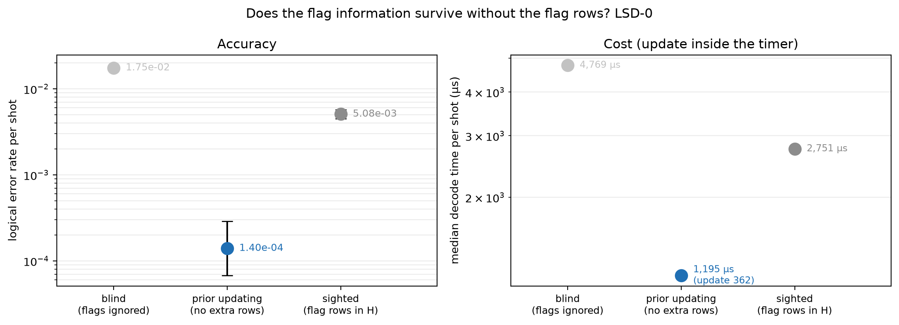
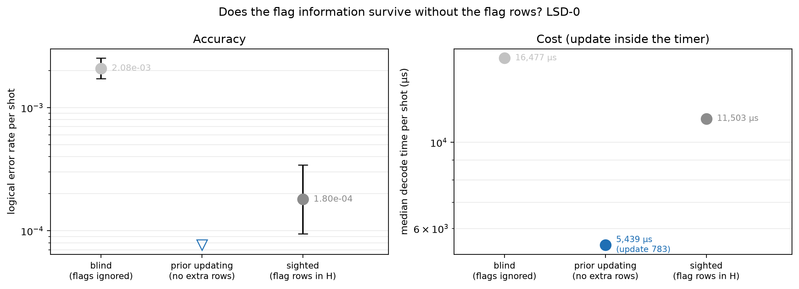

# Experiment 10 — prior updating with BP+LSD-0

Data file: `E10_144-12-12+72-12-6_T12_p0.001_100000shots_seed2026110801_detZ_arms-blind-sighted-updated_dec-LSD-0_cfg5bbbc73d.json` (sha256 `c911e286f63147e7789b96d66b2739db755aa439811f256461a58208c71239a4`)  
Run started: 2026-10-30T01:13:18 · status: complete  
Exported: 2026-10-30T01:50:38 by code 4f290232cf46  
Export type: fresh run

## Table: arms

[arms.csv](arms.csv) — 6 rows

| code | rounds | p | shots | shard | decoder | arm | failures | ler | ci_low | ci_high | time_p50_us | time_p99_us | time_mean_us | time_update_p50_us | bp_iters_mean | detectors | qubits_used | workers | resumed_chunks | seed |
|---|---|---|---|---|---|---|---|---|---|---|---|---|---|---|---|---|---|---|---|---|
| [[72, 12, 6]] | 12 | 0.001 | 50000 | 0 | LSD-0 | blind | 875 | 0.0175 | 0.01639 | 0.01869 | 4769 | 9266 | 4739 | 0 | 26.87 | 468 | 180 | 1 | 0 | 1857614567325396710 |
| [[72, 12, 6]] | 12 | 0.001 | 50000 | 0 | LSD-0 | sighted | 254 | 0.00508 | 0.004494 | 0.005742 | 2751 | 9495 | 3578 | 0 | 16.57 | 900 | 180 | 1 | 0 | 1857614567325396710 |
| [[72, 12, 6]] | 12 | 0.001 | 50000 | 0 | LSD-0 | updated | 7 | 0.00014 | 6.782e-05 | 0.000289 | 1195 | 5919 | 1471 | 361.8 | 4.183 | 468 | 180 | 1 | 0 | 1857614567325396710 |
| [[144, 12, 12]] | 12 | 0.001 | 50000 | 0 | LSD-0 | blind | 104 | 0.00208 | 0.001717 | 0.002519 | 1.648e+04 | 2.821e+04 | 1.734e+04 | 0 | 29.65 | 936 | 360 | 1 | 0 | 8252477738678029781 |
| [[144, 12, 12]] | 12 | 0.001 | 50000 | 0 | LSD-0 | sighted | 9 | 0.00018 | 9.47e-05 | 0.0003421 | 1.15e+04 | 1.885e+04 | 9937 | 0 | 23.5 | 1800 | 360 | 1 | 0 | 8252477738678029781 |
| [[144, 12, 12]] | 12 | 0.001 | 50000 | 0 | LSD-0 | updated | 0 | 0 | 0 | 7.683e-05 | 5439 | 3.052e+04 | 7182 | 783.1 | 6.319 | 936 | 360 | 1 | 0 | 8252477738678029781 |

## Table: comparisons

[comparisons.csv](comparisons.csv) — 6 rows

| code | rounds | p | shots | decoder | comparison | paired | a_only | b_only | ratio | lo | hi | p_value | method |
|---|---|---|---|---|---|---|---|---|---|---|---|---|---|
| [[72, 12, 6]] | 12 | 0.001 | 50000 | LSD-0 | blind|sighted | True | 711 | 90 | 3.445 | None | None | 1.356e-120 | exact McNemar (two-sided) |
| [[72, 12, 6]] | 12 | 0.001 | 50000 | LSD-0 | sighted|updated | True | 249 | 2 | 36.29 | None | None | 1.748e-71 | exact McNemar (two-sided) |
| [[72, 12, 6]] | 12 | 0.001 | 50000 | LSD-0 | blind|updated | True | 871 | 3 | 125 | None | None | 1.767e-255 | exact McNemar (two-sided) |
| [[144, 12, 12]] | 12 | 0.001 | 50000 | LSD-0 | blind|sighted | True | 101 | 6 | 11.56 | None | None | 2.365e-23 | exact McNemar (two-sided) |
| [[144, 12, 12]] | 12 | 0.001 | 50000 | LSD-0 | sighted|updated | True | 9 | 0 | inf | None | None | 0.003906 | exact McNemar (two-sided) |
| [[144, 12, 12]] | 12 | 0.001 | 50000 | LSD-0 | blind|updated | True | 104 | 0 | inf | None | None | 9.861e-32 | exact McNemar (two-sided) |

## Figure: arms_72-12-6_T12_p0.001_s0_LSD-0

  
Vector version: [arms_72-12-6_T12_p0.001_s0_LSD-0.pdf](arms_72-12-6_T12_p0.001_s0_LSD-0.pdf)

## Figure: arms_144-12-12_T12_p0.001_s0_LSD-0

  
Vector version: [arms_144-12-12_T12_p0.001_s0_LSD-0.pdf](arms_144-12-12_T12_p0.001_s0_LSD-0.pdf)
