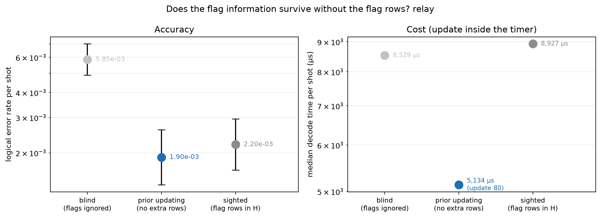
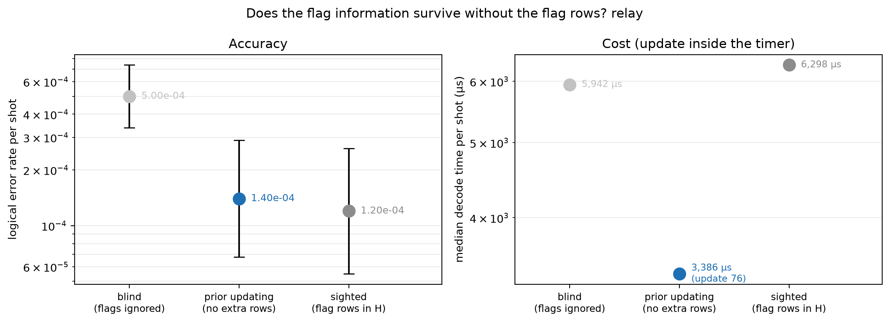
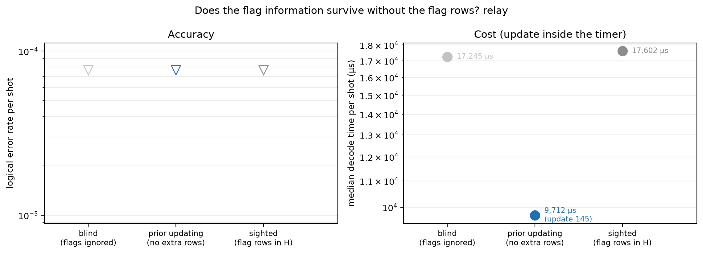

# Experiment 11 — prior updating with Relay-BP

Data file: `E11_144-12-12+72-12-6_T12_p0.001-0.002x2_120000shots_seed2026110801_detZ_arms-blind-sighted-updated_dec-relay_cfga1d2fb60.json` (sha256 `37fec415c13caf2b10a453b6c159f29f09d5ef83d5692cf02f51725558f77adc`)  
Run started: 2026-10-30T01:57:41 · status: complete  
Exported: 2026-10-30T03:03:09 by code 4f290232cf46  
Export type: fresh run

## Table: arms

[arms.csv](arms.csv) — 9 rows

| code | rounds | p | shots | shard | decoder | arm | failures | ler | ci_low | ci_high | time_p50_us | time_p99_us | time_mean_us | time_update_p50_us | bp_iters_mean | detectors | qubits_used | workers | resumed_chunks | seed |
|---|---|---|---|---|---|---|---|---|---|---|---|---|---|---|---|---|---|---|---|---|
| [[72, 12, 6]] | 12 | 0.002 | 20000 | 0 | relay | blind | 117 | 0.00585 | 0.004884 | 0.007006 | 8529 | 3.849e+04 | 1.02e+04 | 0 | 77.02 | 468 | 180 | 1 | 0 | 4105339059150540127 |
| [[72, 12, 6]] | 12 | 0.002 | 20000 | 0 | relay | sighted | 44 | 0.0022 | 0.001639 | 0.002952 | 8927 | 2.925e+04 | 1.011e+04 | 0 | 65.54 | 900 | 180 | 1 | 0 | 4105339059150540127 |
| [[72, 12, 6]] | 12 | 0.002 | 20000 | 0 | relay | updated | 38 | 0.0019 | 0.001385 | 0.002607 | 5134 | 1.859e+04 | 5798 | 80.1 | 42.8 | 468 | 180 | 1 | 0 | 4105339059150540127 |
| [[72, 12, 6]] | 12 | 0.001 | 50000 | 0 | relay | blind | 25 | 0.0005 | 0.0003387 | 0.000738 | 5942 | 1.92e+04 | 6579 | 0 | 49.18 | 468 | 180 | 1 | 0 | 1857614567325396710 |
| [[72, 12, 6]] | 12 | 0.001 | 50000 | 0 | relay | sighted | 6 | 0.00012 | 5.5e-05 | 0.0002618 | 6298 | 1.921e+04 | 6816 | 0 | 43.86 | 900 | 180 | 1 | 0 | 1857614567325396710 |
| [[72, 12, 6]] | 12 | 0.001 | 50000 | 0 | relay | updated | 7 | 0.00014 | 6.782e-05 | 0.000289 | 3386 | 1.046e+04 | 3722 | 76 | 27.28 | 468 | 180 | 1 | 0 | 1857614567325396710 |
| [[144, 12, 12]] | 12 | 0.001 | 50000 | 0 | relay | blind | 0 | 0 | 0 | 7.683e-05 | 1.725e+04 | 5.436e+04 | 1.97e+04 | 0 | 73.53 | 936 | 360 | 1 | 0 | 8252477738678029781 |
| [[144, 12, 12]] | 12 | 0.001 | 50000 | 0 | relay | sighted | 0 | 0 | 0 | 7.683e-05 | 1.76e+04 | 5.112e+04 | 1.982e+04 | 0 | 63.49 | 1800 | 360 | 1 | 0 | 8252477738678029781 |
| [[144, 12, 12]] | 12 | 0.001 | 50000 | 0 | relay | updated | 0 | 0 | 0 | 7.683e-05 | 9712 | 2.782e+04 | 1.058e+04 | 144.8 | 38.62 | 936 | 360 | 1 | 0 | 8252477738678029781 |

## Table: comparisons

[comparisons.csv](comparisons.csv) — 9 rows

| code | rounds | p | shots | decoder | comparison | paired | a_only | b_only | ratio | lo | hi | p_value | method |
|---|---|---|---|---|---|---|---|---|---|---|---|---|---|
| [[72, 12, 6]] | 12 | 0.002 | 20000 | relay | blind|sighted | True | 94 | 21 | 2.659 | None | None | 3.24e-12 | exact McNemar (two-sided) |
| [[72, 12, 6]] | 12 | 0.002 | 20000 | relay | sighted|updated | True | 25 | 19 | 1.158 | None | None | 0.4514 | exact McNemar (two-sided) |
| [[72, 12, 6]] | 12 | 0.002 | 20000 | relay | blind|updated | True | 95 | 16 | 3.079 | None | None | 7.52e-15 | exact McNemar (two-sided) |
| [[72, 12, 6]] | 12 | 0.001 | 50000 | relay | blind|sighted | True | 21 | 2 | 4.167 | None | None | 6.604e-05 | exact McNemar (two-sided) |
| [[72, 12, 6]] | 12 | 0.001 | 50000 | relay | sighted|updated | True | 1 | 2 | 0.8571 | None | None | 1 | exact McNemar (two-sided) |
| [[72, 12, 6]] | 12 | 0.001 | 50000 | relay | blind|updated | True | 21 | 3 | 3.571 | None | None | 0.0002772 | exact McNemar (two-sided) |
| [[144, 12, 12]] | 12 | 0.001 | 50000 | relay | blind|sighted | True | 0 | 0 | inf | None | None | 1 | exact McNemar (two-sided) |
| [[144, 12, 12]] | 12 | 0.001 | 50000 | relay | sighted|updated | True | 0 | 0 | inf | None | None | 1 | exact McNemar (two-sided) |
| [[144, 12, 12]] | 12 | 0.001 | 50000 | relay | blind|updated | True | 0 | 0 | inf | None | None | 1 | exact McNemar (two-sided) |

## Figure: arms_72-12-6_T12_p0.002_s0_relay

  
Vector version: [arms_72-12-6_T12_p0.002_s0_relay.pdf](arms_72-12-6_T12_p0.002_s0_relay.pdf)

## Figure: arms_72-12-6_T12_p0.001_s0_relay

  
Vector version: [arms_72-12-6_T12_p0.001_s0_relay.pdf](arms_72-12-6_T12_p0.001_s0_relay.pdf)

## Figure: arms_144-12-12_T12_p0.001_s0_relay

  
Vector version: [arms_144-12-12_T12_p0.001_s0_relay.pdf](arms_144-12-12_T12_p0.001_s0_relay.pdf)
