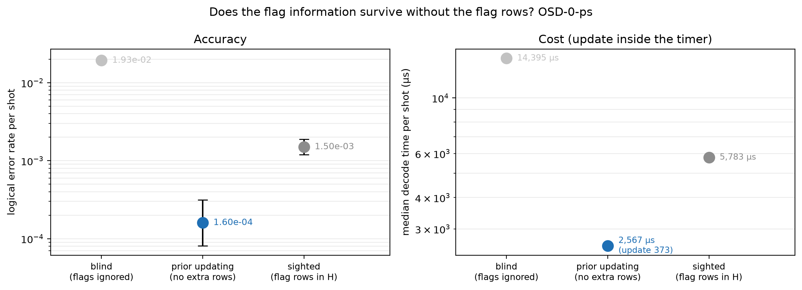
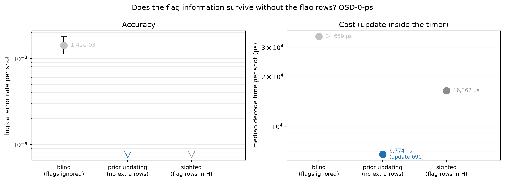

# Experiment 12 — sum-product arms

Data file: `E12_144-12-12+72-12-6_T12_p0.001_100000shots_seed2026110801_detZ_arms-blind-sighted-updated_dec-OSD-0-ps_cfg6cc33aa1.json` (sha256 `53dcd0ff13337cffa127dfcba0a36e65306b21abb4961d9c775b1c86fec525c5`)  
Run started: 2026-10-30T03:13:50 · status: complete  
Exported: 2026-10-30T04:25:56 by code 4f290232cf46  
Export type: fresh run

## Table: arms

[arms.csv](arms.csv) — 6 rows

| code | rounds | p | shots | shard | decoder | arm | failures | ler | ci_low | ci_high | time_p50_us | time_p99_us | time_mean_us | time_update_p50_us | bp_iters_mean | detectors | qubits_used | workers | resumed_chunks | seed |
|---|---|---|---|---|---|---|---|---|---|---|---|---|---|---|---|---|---|---|---|---|
| [[72, 12, 6]] | 12 | 0.001 | 50000 | 0 | OSD-0-ps | blind | 964 | 0.01928 | 0.01811 | 0.02052 | 1.439e+04 | 2.755e+04 | 1.401e+04 | 0 | 24.42 | 468 | 180 | 1 | 0 | 1857614567325396710 |
| [[72, 12, 6]] | 12 | 0.001 | 50000 | 0 | OSD-0-ps | sighted | 75 | 0.0015 | 0.001197 | 0.00188 | 5783 | 2.29e+04 | 7286 | 0 | 10.48 | 900 | 180 | 1 | 0 | 1857614567325396710 |
| [[72, 12, 6]] | 12 | 0.001 | 50000 | 0 | OSD-0-ps | updated | 8 | 0.00016 | 8.108e-05 | 0.0003157 | 2567 | 1.472e+04 | 3332 | 372.9 | 3.396 | 468 | 180 | 1 | 0 | 1857614567325396710 |
| [[144, 12, 12]] | 12 | 0.001 | 50000 | 0 | OSD-0-ps | blind | 71 | 0.00142 | 0.001126 | 0.001791 | 3.466e+04 | 5.541e+04 | 3.502e+04 | 0 | 28.59 | 936 | 360 | 1 | 0 | 8252477738678029781 |
| [[144, 12, 12]] | 12 | 0.001 | 50000 | 0 | OSD-0-ps | sighted | 0 | 0 | 0 | 7.683e-05 | 1.636e+04 | 4.252e+04 | 1.824e+04 | 0 | 15.51 | 1800 | 360 | 1 | 0 | 8252477738678029781 |
| [[144, 12, 12]] | 12 | 0.001 | 50000 | 0 | OSD-0-ps | updated | 0 | 0 | 0 | 7.683e-05 | 6774 | 2.867e+04 | 7883 | 689.6 | 5.016 | 936 | 360 | 1 | 0 | 8252477738678029781 |

## Table: comparisons

[comparisons.csv](comparisons.csv) — 6 rows

| code | rounds | p | shots | decoder | comparison | paired | a_only | b_only | ratio | lo | hi | p_value | method |
|---|---|---|---|---|---|---|---|---|---|---|---|---|---|
| [[72, 12, 6]] | 12 | 0.001 | 50000 | OSD-0-ps | blind|sighted | True | 920 | 31 | 12.85 | None | None | 1.699e-228 | exact McNemar (two-sided) |
| [[72, 12, 6]] | 12 | 0.001 | 50000 | OSD-0-ps | sighted|updated | True | 70 | 3 | 9.375 | None | None | 1.374e-17 | exact McNemar (two-sided) |
| [[72, 12, 6]] | 12 | 0.001 | 50000 | OSD-0-ps | blind|updated | True | 959 | 3 | 120.5 | None | None | 7.613e-282 | exact McNemar (two-sided) |
| [[144, 12, 12]] | 12 | 0.001 | 50000 | OSD-0-ps | blind|sighted | True | 71 | 0 | inf | None | None | 8.47e-22 | exact McNemar (two-sided) |
| [[144, 12, 12]] | 12 | 0.001 | 50000 | OSD-0-ps | sighted|updated | True | 0 | 0 | inf | None | None | 1 | exact McNemar (two-sided) |
| [[144, 12, 12]] | 12 | 0.001 | 50000 | OSD-0-ps | blind|updated | True | 71 | 0 | inf | None | None | 8.47e-22 | exact McNemar (two-sided) |

## Table: gap

[gap.csv](gap.csv) — 2 rows

| code | p | decoder | sighted | updated | ratio | sighted_only | updated_only | p_mcnemar |
|---|---|---|---|---|---|---|---|---|
| [[72, 12, 6]] | 0.001 | OSD-0-ps | 75 | 8 | 9.375 | 70 | 3 | 1.374e-17 |
| [[144, 12, 12]] | 0.001 | OSD-0-ps | 0 | 0 | None | 0 | 0 | 1 |

## Table: min_sum_vs_sum_product

[min_sum_vs_sum_product.csv](min_sum_vs_sum_product.csv) — 0 rows

## Figure: arms_72-12-6_T12_p0.001_s0_OSD-0-ps

  
Vector version: [arms_72-12-6_T12_p0.001_s0_OSD-0-ps.pdf](arms_72-12-6_T12_p0.001_s0_OSD-0-ps.pdf)

## Figure: arms_144-12-12_T12_p0.001_s0_OSD-0-ps

  
Vector version: [arms_144-12-12_T12_p0.001_s0_OSD-0-ps.pdf](arms_144-12-12_T12_p0.001_s0_OSD-0-ps.pdf)
