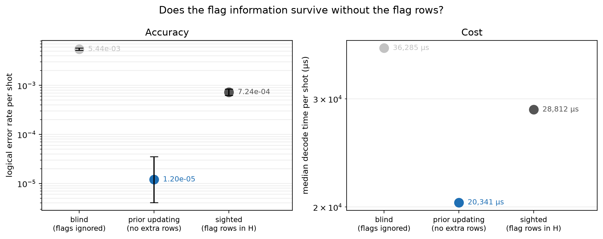

# Experiment 9 dynamic prior updating — [[288, 12, 18]], T=12, p=0.003

Data file: `EXP9_288-12-18_T12_p0.003_250000shots_seed20260930_osd0.json`  
Exported: 2026-10-28T04:24:22

**Prior updating recovers 115% of the gap between the blind and sighted arms**, on a check matrix 1872 × 22752 rather than 3600 × 22752 — 1.92× fewer entries.  
It matches the sighted arm within 5%, so the flag rows buy nothing that the exact one-shot posterior does not already capture.

## Table: arms

[arms.csv](arms.csv) — 3 rows

| arm | failures | ler | ci_low | ci_high | time_p50_us | time_p99_us | detectors | faults |
|---|---|---|---|---|---|---|---|---|
| blind | 1361 | 0.005444 | 0.005163 | 0.00574 | 3.629e+04 | 1.966e+05 | 1872 | 22752 |
| updated | 3 | 1.2e-05 | 4.081e-06 | 3.528e-05 | 2.034e+04 | 2.887e+04 | 1872 | 22752 |
| sighted | 181 | 0.000724 | 0.000626 | 0.0008374 | 2.881e+04 | 8.337e+04 | 3600 | 22752 |

## Figure: prior_update

  
Vector version: [prior_update.pdf](prior_update.pdf)
